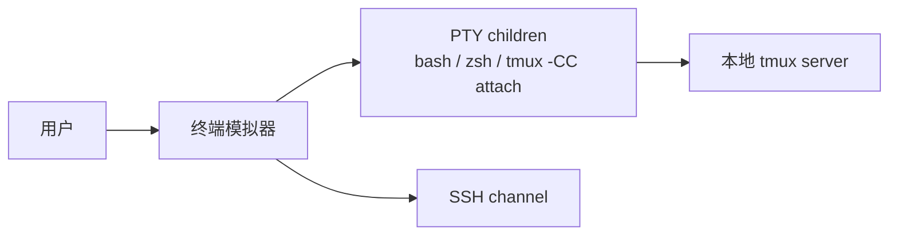
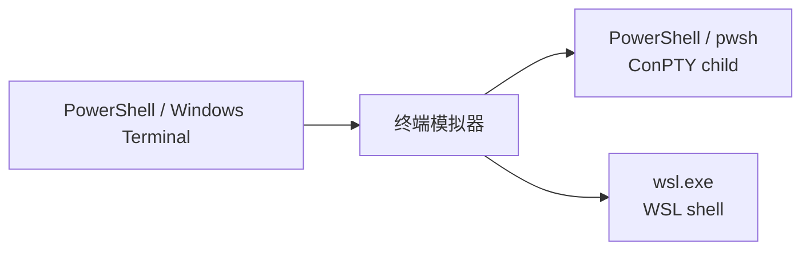
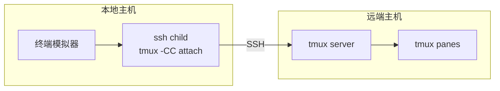

# 部署视图

本文描述终端模拟器在 Linux、WSL、Windows 与远端环境中的部署单元、进程位置、网络
路径与运行时依赖。权威模型见 [terminal-emulator.md](./terminal-emulator.md)。

## 1. 部署单元

| 单元 | 数量 | 位置 | 生命周期 |
|---|---:|---|---|
| 终端模拟器（后端 + 模拟前端） | 1 个二进制 | 用户主机 | 应用运行期间 |
| 本地 Shell 子进程 | 每个 LocalDomain 1 个 | 用户主机 | 随 pane 生命周期 |
| SSH channel | 每个 RemoteSshDomain 1 个 | 用户主机 → 远端 | 随 pane 生命周期 |
| tmux 控制 PTY | 每个 TmuxDomain 1 个 | 用户主机 | 随容器生命周期 |
| tmux server | 每个 tmux 目标 0..1 | 本地或 SSH 目标机 | 独立于终端模拟器 |

本项目当前只交付后端库（L0–L2）；模拟前端作为开发验证入口，不面向最终用户发布。

## 2. Linux / WSL 本机部署



### 依赖

- Linux/WSL 用户态 PTY
- `tmux` 3.x：仅 tmux 会话需要
- `ssh`：远端 tmux 控制客户端与 RemoteSshDomain 需要

### 构建

```bash
cargo build --release
```

## 3. Windows 原生部署



### 依赖

- Windows 10/11 ConPTY
- `powershell.exe`：Windows PowerShell 5.1
- `pwsh.exe`：PowerShell 7，可选
- `wsl.exe`：WSL shell，可选
- Windows 本地 tmux 不受支持；WSL-local tmux 应在 WSL 内运行本程序

## 4. Windows 连接 WSL

### Windows 内启动 WSL shell

```text
终端模拟器 -> ConPTY -> wsl.exe --distribution Ubuntu --exec /bin/bash
```

适用于使用 WSL 内 bash/tools 的场景。

### 在 WSL 内运行本程序

```text
wsl.exe -> Linux 终端模拟器 -> WSL PTY -> WSL tmux server
```

需要在 WSL 内安装 Linux 版程序，本地 Shell 直接使用 WSL 文件系统路径。

## 5. 远端 tmux 部署



- 远端主机不需要安装本程序。
- 本地持有 SSH 与 tmux 控制客户端。
- tmux Session/Window/Pane 结构仍在远端 tmux server。
- 认证沿用系统 `ssh`，`~/.ssh/config`、`ProxyJump`、agent 转发均生效。

## 6. 远端 SSH 会话部署

```text
终端模拟器 -> L0 SSH 客户端 -> 远端 SSH server -> 远端 PTY channel
```

RemoteSshDomain 是独立连接，不要求远端有本程序或 tmux。

## 7. 运行目录与权限

| 资源 | 权限边界 |
|---|---|
| PTY/ConPTY child | 终端模拟器进程权限 |
| SSH channel | 用户 SSH 凭据与远端账号权限 |
| tmux 控制 PTY | 用户对本机 tmux server 的访问权限 |
| 串口设备（如将来接入） | 依赖操作系统设备权限 |

推荐：

- 远端 SSH 使用专用 key，避免复用高权限账号。
- tmux 控制会话沿用系统 `ssh` 的配置与凭据，不自行存储密码。

## 8. 升级与迁移

- 后端库（L0–L2）替换为二进制升级即可，不涉及持久化格式。
- 模拟前端只用于开发验证，可整体替换为真实前端（L3–L5 真实实现）。
- 外部 tmux server 与远端 SSH server 不受升级影响。

## 9. 平台限制

- Windows 原生不管理 Windows 本地 tmux；tmux 会话需在 WSL/Linux 内运行。
- 远端 tmux 依赖本地环境中的 SSH 凭据。
- `%output` 是实时流，不重放历史；控制客户端断开期间的输出不可恢复。
- 网格状态为内存态，不承诺跨进程或重启持久化。
