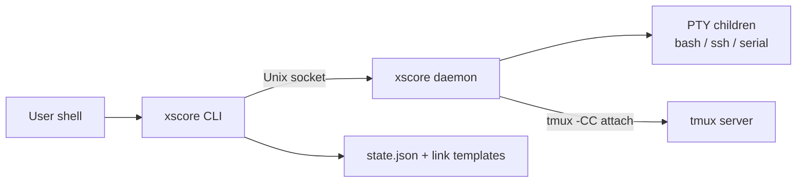
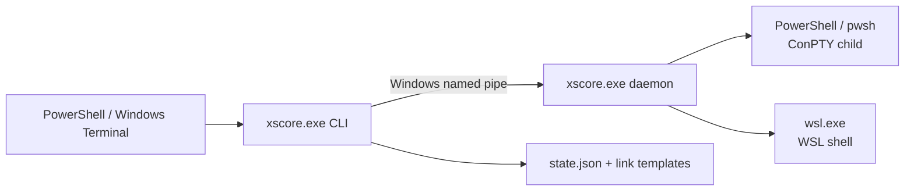
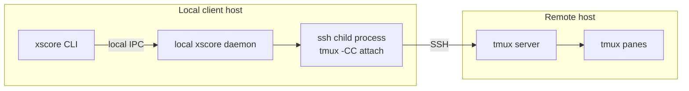

# 部署视图

本文描述 xscore 在 Linux、WSL、Windows 和远端 tmux 环境中的部署单元、进程位置、网络/IPC 路径和运行时依赖。

## 1. 部署单元

| 单元 | 数量 | 位置 | 生命周期 |
|---|---:|---|---|
| `xscore` / `xscore.exe` | 1 个二进制 | 用户 PATH 或项目 target | CLI 进程每次命令启动 |
| daemon | 每个用户配置根 1 个 | 与 CLI 相同主机 | 按需自动启动或显式 serve |
| shell child | 每个 native Link 1 个 | CLI 所在主机 | 由 daemon 持有 PTY/ConPTY |
| tmux control client | 每个 tmux Session 1 个 | daemon 所在主机 | 由 daemon 持有 |
| tmux server | 每个 tmux目标 0..1 | 本地或 SSH 目标机 | 独立于 xscore |

当前没有远程 xscore agent、systemd unit、Windows Service 或容器运行时依赖。

## 2. Linux / WSL 本机部署



### 依赖

- Linux/WSL 用户态
- PTY 支持
- `tmux` 3.x：仅 tmux Session 需要
- `ssh`：远端 tmux control client 需要；native SSH Link 使用 russh
- 串口权限：仅 `serial://` 需要

### 安装

```bash
cargo build --release
install -m755 target/release/xscore ~/.local/bin/xscore
```

### 文件

```text
$HOME/.config/xscore/
  links/<name>.json
  state/state.json
  run/daemon.sock          # XDG_RUNTIME_DIR 未设置时
```

若 `XDG_RUNTIME_DIR` 已设置：

```text
$XDG_RUNTIME_DIR/xscore/daemon.sock
```

## 3. Windows 原生部署



### 依赖

- Windows 10/11 ConPTY
- `powershell.exe`：Windows PowerShell 5.1
- `pwsh.exe`：PowerShell 7，可选
- `wsl.exe`：WSL shell，可选
- Windows 本地 tmux 不受支持；WSL-local tmux 应在 WSL 内运行 xscore

### 安装

```powershell
cargo build --release
Copy-Item .\target\release\xscore.exe "$env:USERPROFILE\bin\xscore.exe"
```

### 文件与 IPC

```text
%USERPROFILE%\.config\xscore\
  links\<name>.json
  state\state.json
```

daemon IPC 不使用 TCP 端口，而是使用由用户配置路径稳定派生的 named pipe：

```text
\\.\pipe\xscore-<16-hex-hash>
```

其中 hash 用于隔离不同用户和测试 HOME。

## 4. Windows 连接 WSL

目前有两类部署方式：

### 4.1 Windows daemon 启动 WSL shell

```text
xscore.exe
  -> Windows daemon
  -> ConPTY
  -> wsl.exe --distribution Ubuntu --exec /bin/bash
```

适用于使用 WSL 内 bash/tools 的场景。进程和 Buffer 仍由 Windows daemon 持有。

### 4.2 在 WSL 内运行 xscore

```text
wsl.exe
  -> Linux xscore
  -> WSL daemon
  -> WSL PTY
  -> WSL tmux server
```

需要在 WSL 内安装 Linux 版 `xscore`。`shell:///bin/bash` 直接使用 WSL 的文件系统路径。

## 5. 远端 tmux 部署



- 远端主机不需要安装 xscore。
- 本地 daemon 持有 SSH 和 tmux control client。
- tmux Session、Window、Pane 结构仍在远端 tmux server。
- 认证和 ssh 参数由 `session new --tmux --ssh <dest>` 提供。

## 6. native SSH Link 部署

```text
xscore CLI
  -> local daemon
  -> russh client
  -> remote SSH server
```

native SSH Link 不是 tmux Session，也不要求远端有 xscore/tmux。当前 `ssh://` 传输接受服务器 host key，尚未实现 `known_hosts` 校验。

## 7. 运行目录与权限

| 资源 | 权限边界 |
|---|---|
| `state.json` | 当前用户可读写 |
| link templates | 当前用户可读写 |
| Unix daemon socket | 用户 runtime/config 目录 |
| Windows named pipe | 当前用户路径派生名称 |
| PTY/ConPTY child | xscore 进程权限 |
| serial device | 依赖操作系统设备权限 |

推荐：

- 保持配置目录仅当前用户可访问。
- 不在共享多用户机器上使用同一 HOME 运行 daemon。
- 远端 SSH 使用专用 key，避免复用高权限账号。

## 8. 升级与迁移

1. 停止 daemon。
2. 替换 `xscore` 二进制。
3. 如 state schema 变化，运行：

```bash
xscore state migrate
```

4. 重启 daemon 或让下一条命令自动拉起。

daemon 内存中的 Buffer 不参与升级；停止 daemon 会丢失这些字节。`state.json`、link templates 和外部 tmux server 不受影响。

## 9. 平台限制

- Windows 原生 daemon 不管理 Windows 本地 tmux。
- 远端 tmux 依赖本地 daemon 环境中的 SSH 凭据。
- daemon 启动后新增的 SSH key 可能需要 `daemon stop` 后才生效。
- Buffer 是 64 KiB 内存历史，不是持久化日志。
- 同一 state 文件的并发写仍是 last-writer-wins。
