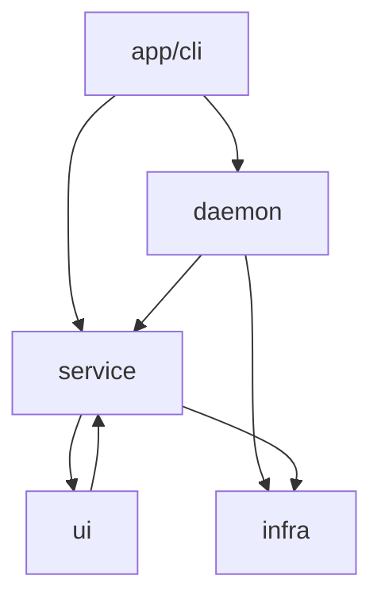

# 开发视图

本文描述当前代码的模块划分、依赖方向、构建方式和扩展点。逻辑职责见[逻辑视图](./view-logic.md)。

## 1. 仓库与构建单元

当前 workspace 只有一个库 crate 和一个 CLI binary：

```text
Cargo.toml
crates/xscore/
  Cargo.toml
  src/
    lib.rs
    main.rs
  tests/
    cli_smoke.rs
    data_smoke.rs
    tmux_control_smoke.rs
    windows_smoke.rs
```

- `lib.rs` 暴露 `app`、`daemon`、`service`、`ui`、`infra` 模块。
- `main.rs` 解析 CLI、装配 `SessionService` 和 `DaemonClient`，然后分发命令。
- Lua、MCP 或独立渲染器尚未接入。
- 当前发布产物是一个 `xscore`/`xscore.exe` 可执行文件。

## 2. 源码结构

```text
crates/xscore/src/
  app/
    cli/
      buffer.rs
      daemon.rs
      data.rs
      link.rs
      pane.rs
      session.rs
      state.rs
      window.rs
    mcp/
      mod.rs                 future adapter, not implemented

  ui/
    event.rs                 UiEvent
    pane.rs                  PaneId, PaneInfo
    pane_registry.rs
    window.rs                WindowId, WindowInfo, WindowBackend, Window
    window_registry.rs

  daemon/
    client.rs                requests, auto-start, DaemonTransport
    ipc.rs                   Unix socket / Windows named pipe
    port.rs                  DaemonPort implementation
    protocol.rs              wire messages
    server.rs                daemon state, pumps and request handling

  service/
    backend/
      daemon_port.rs         outbound runtime port
      mod.rs                 BackendRuntime, BackendEvent
      raw.rs                 raw Link -> Buffer routing
      tmux.rs                %N -> Buffer and tmux event translation
      tmux_model.rs          tmux structure DTOs
      tmux_runtime.rs        in-process tmux clients and locks
    buffer_service/
      mod.rs                 BufferService API and data-plane methods
      store.rs               Buffer model + registry
      ring.rs                64 KiB non-destructive ring
      runtime.rs             Local/Daemon/Control runtime dispatch
    link_service/
      mod.rs                 LinkService API
      store.rs               Link model, runtime row and registry
    session_service/
      service.rs             Session lifecycle and composition
      model.rs               Session model
      store.rs               Session row + registry
      link_methods.rs
      tmux_methods.rs
      tmux_reconcile_methods.rs
      ui_methods.rs
      data_methods.rs
      persistence_methods.rs
    ui_projection/
      mod.rs                 Window/Pane use cases
    persistence/
      snapshot.rs            serialized state model
      store.rs               save/load/parse
      migrate.rs             schema migrations

  infra/
    link/
      address.rs
      config.rs
      pty.rs                 PTY/ConPTY
      ssh.rs                 russh transport
      serial.rs
      factory.rs
    tmux/
      control.rs             tmux -CC process and protocol reader
      protocol.rs
      format.rs
      model.rs
    url/
    config/
    util/

  error.rs
  macros.rs
```

## 3. 模块依赖



依赖说明：

- `app` 是组合根，负责 CLI、路径解析和依赖注入。
- `daemon` 实现 service 定义的 `DaemonPort`，反向依赖 service 的 ID/DTO。
- `service` 不知道 `daemon` 实现，只依赖 `DaemonPort`。
- `infra` 不依赖 app、service、daemon 或 UI。
- `ui` 当前通过 `BufferId`/`SessionId` 引用 service 模型，因此 `ui <-> service` 在模型层是有意存在的窄循环。该循环不得扩展到 runtime 或 I/O。

### 依赖矩阵

| 来源 | 允许依赖 | 禁止依赖 |
|---|---|---|
| app | service、daemon、infra 入口 | 具体 runtime 内部状态 |
| daemon | service 的模型/端口、infra | SessionService 业务编排 |
| service | ui 的投影 API、infra 的适配器接口 | daemon 实现 |
| ui | service 的 ID/DTO | PTY、SSH、tmux、daemon |
| infra | 本层模块、crate error | service 业务逻辑、daemon、app |

## 4. Service 内部职责

| 模块 | 事务边界 | 持久化 | Runtime |
|---|---|---|---|
| `SessionService` | Session 生命周期和跨 Service 用例 | 通过 persistence 保存快照 | 协调 backend/tmux |
| `BufferService` | Buffer 数据和 runtime | Buffer 元数据 | ring、Local/Daemon/Control |
| `LinkService` | Link 生命周期 API | Link 元数据 | transport handle |
| `UiProjection` | Window/Pane 行 | 行由 SessionService 保存 | 无字节 runtime |
| `BackendRuntime` | 无持久化 | 无 | Raw/Tmux 路由 |
| `TmuxRuntime` | 无持久化 | 无 | control client 和锁 |

## 5. 扩展点

### 新连接类型

在 `infra/link/` 增加具体 `Transport`，并在 factory/URL parser 中注册。不要修改 Pane。

### 新 Backend

1. 在 `service/backend/` 增加 backend 路由类型。
2. 扩展 `SessionBackend` 和 `BackendRuntime`。
3. 将 backend 输出转换为 Buffer 写入或 `BackendEvent`。
4. 在 SessionService 只增加用例编排，不把协议细节写回 UI。

### 新 Daemon 实现

实现 `service::backend::DaemonPort`，在 app 组合根注入。service 不需要知道 IPC 是 socket、pipe 还是未来的 RPC。

### 新 UI

只消费 `WindowInfo`、`PaneInfo`、`UiEvent` 和 Buffer ID。UI 不得打开 Link，也不得读取 transport。

## 6. 数据模型规则

- 每个模型跟随拥有它的模块，不设统一 `domain/` 目录。
- ID 类型通过 `macros.rs` 的 `uuid_id!` 在所有者模块定义。
- Persistence snapshot 只引用模型，不复制运行态 bridge/runtime。
- `BufferOrigin` 是数据源事实，不能被 Pane 字段替代。
- tmux handle 只出现在 WindowBackend、BufferOrigin 和 DTO 中。

## 7. 构建与测试

```bash
cargo build --release
cargo test --workspace --all-targets -- --test-threads=1
cargo clippy --workspace --all-targets -- -D warnings
cargo fmt --all -- --check
```

测试分层：

| 测试 | 目的 | 平台 |
|---|---|---|
| unit tests | 协议、解析、state、Buffer、服务路由 | 所有平台 |
| `windows_smoke` | named pipe、ConPTY、PowerShell、CLI rollback | Windows |
| `cli_smoke` | 多进程 CLI、daemon、断线恢复 | Unix |
| `data_smoke` | in-process raw/tmux 数据路径 | Unix |
| `tmux_control_smoke` | 真 tmux 控制模式，默认 ignored | Unix |

## 8. 开发约束

- 新代码优先增加在拥有该状态的 Service 内。
- 不新增 `XXXBridge` 或仅做转发的 manager。
- 不把 daemon 实现重新放回 service。
- 不让 UI 依赖进程和连接。
- tmux/reconciliation 只通过事件或明确的结构快照更新 UI。
- 所有跨 Session 的关联必须在修改前校验，不能做隐式转移。
