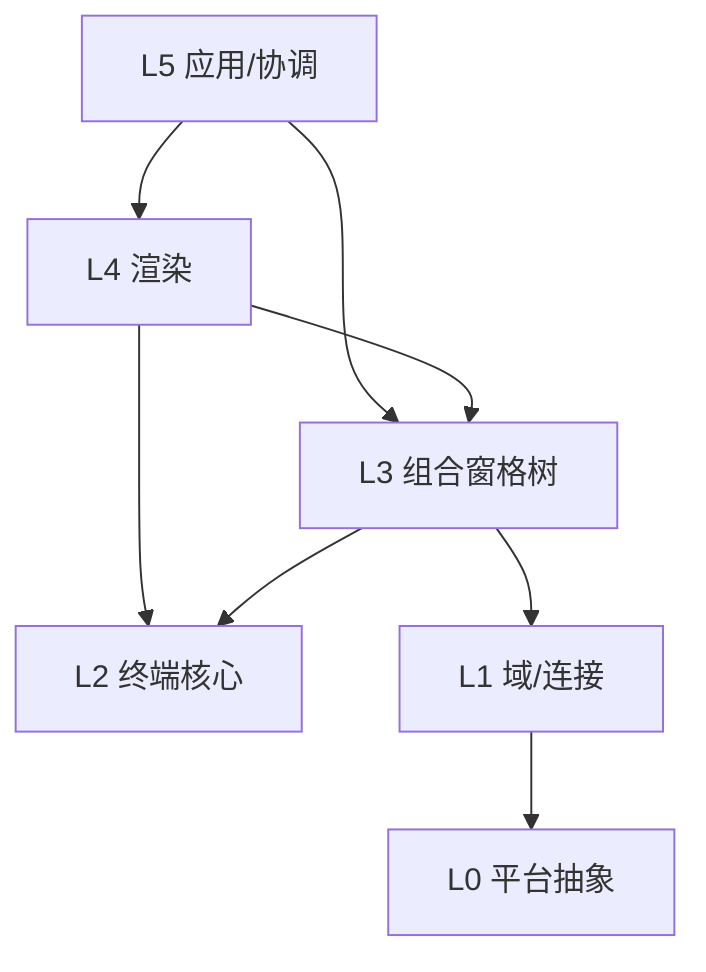

# 开发视图

本文描述目标模块划分、依赖方向、构建方式与扩展点。逻辑职责见
[逻辑视图](./view-logic.md)，权威模型见 [terminal-emulator.md](./terminal-emulator.md)。

## 1. 范围与构建单元

本项目只实现后端层 L0–L2；前端层 L3–L5 用模拟/桩运行以验证后端。目标 workspace
划分为两个 crate：

```text
Cargo.toml
crates/
  emulator/              # 后端库（L0–L2），本项目实现
    src/
      platform/          # L0
      domain/            # L1
      term/              # L2
      event.rs
      error.rs
      lib.rs
  emulator-frontend/     # 前端模拟（L3–L5），桩实现
    src/
      tree.rs            # L3 Node / TmuxContainer
      render.rs          # L4 桩渲染（文本/帧输出）
      app.rs             # L5 协调
      main.rs            # 模拟驱动：喂字节、打印网格
```

当前 `crates/xscore`（CLI + daemon）是旧架构的前身，不属于本视图描述的目标结构；
新后端以独立 crate 构建，迁移方式不在本视图范围内。

## 2. 后端模块结构（L0–L2）

```text
crates/emulator/src/
  platform/                  # L0 平台抽象
    mod.rs                   # PtyTransport / SshTransport 接口
    pty.rs                   # Unix /dev/ptmx，Windows ConPTY
    process.rs               # 子进程 + PTY 绑定 + TIOCSWINSZ/SIGWINCH
    ssh.rs                   # TCP、认证、channel、pty-req/window-change
    size.rs                  # 尺寸原语

  domain/                    # L1 域/连接抽象
    mod.rs                   # Domain / PaneHandle trait、PaneKind
    registry.rs              # DomainRegistry
    local.rs                 # LocalDomain
    ssh.rs                   # RemoteSshDomain
    tmux/
      mod.rs                 # TmuxDomain（1:N）
      protocol.rs            # %output/%layout-change/%begin/%end 解析
      layout.rs              # layout string -> TmuxLayoutTree

  term/                      # L2 终端模拟核心
    mod.rs                   # TerminalCore trait、GridSnapshot
    vte.rs                   # VT100/xterm 状态机
    grid.rs                  # 网格缓冲区、光标、滚动区

  event.rs                   # 层间单向事件
  error.rs
  lib.rs
```

## 3. 模块依赖



依赖说明：

- L0 只依赖操作系统原语，不依赖上层任何模块。
- L1 只依赖 L0；tmux 控制协议解析封装在 `TmuxDomain` 内部。
- L2 是纯逻辑层，不依赖 L0/L1；它消费经上层注入的字节流与 `GridSnapshot`。
- L3 组合 L1 的 `PaneHandle` 与 L2 的 `TerminalCore`，不感知具体连接类型。
- L4 只读 L2 的 `GridSnapshot` 与 L3 的布局树，不持有 `PaneHandle`。
- L5 是组合根，持有 `DomainRegistry`、焦点与生命周期管理器。

### 依赖矩阵

| 层 | 允许依赖 | 禁止依赖 |
|---|---|---|
| L0 | OS 原语 | L1–L5 |
| L1 | L0 | L2–L5 |
| L2 | 无（纯逻辑） | L0/L1、L3–L5 |
| L3 | L1（PaneHandle）、L2（TerminalCore） | L0、L4/L5 |
| L4 | L2（snapshot）、L3（布局树） | L0/L1、L5 |
| L5 | L3/L4、L1（DomainRegistry） | 直接触达 L0/L2 内部状态 |

## 4. 分层职责

| 层 | 事务边界 | 持久化 | 运行时 |
|---|---|---|---|
| L0 | 单次 I/O 原语 | 无 | reader/writer 线程或协程 |
| L1 | Connection 与 PaneHandle 生命周期 | 无 | 每连接 reader、tmux 常驻 reader |
| L2 | 单 pane 网格状态 | 无 | feed 增量解析 |
| L3 | 布局树与容器生命周期 | 无（前端模拟） | 布局计算、事件转发 |
| L4 | 帧渲染 | 无 | 脏区重绘 |
| L5 | 全局编排 | 由前端决定（当前模拟） | 主事件循环 |

## 5. 扩展点

### 新连接类型（新 Domain）

在 `domain/` 增加一个 `Domain` 实现：维护自己的 `Connection` 与 pane 注册表，向
上层暴露统一的 `PaneHandle`。不修改 L2/L3。

### 新传输后端（L0）

实现 `PtyTransport` / `SshTransport` 同形接口，并在 `platform` 注册。上层不感知。

### 新渲染后端（L4）

替换 `emulator-frontend` 的桩渲染：只消费 `GridSnapshot` 与布局树，不得持有
`PaneHandle`、不得打开连接。

### 从模拟前端升级到真实前端

保留 `emulator`（L0–L2）不变，替换 `emulator-frontend` 为真实渲染与窗口实现；L3
的节点类型与 `TmuxContainer` 契约保持不变。

## 6. 数据模型规则

- L1 对外只暴露 `PaneHandle` 与 `PaneKind`，连接基数的差异封装在域内路由表。
- L2 每个 PaneHandle 独立实例，状态不跨 pane 共享。
- `TmuxContainer` 的内部 pane 不出现在本地 `Node` 枚举，类型上不可表达混排。
- `%output` 解码后的原始字节不经任何字符渲染，直接进入对应 pane 的 L2 实例。
- 尺寸只通过容器整体同步，不对容器内单个 pane 发 resize。

## 7. 构建与测试

```bash
cargo build --release
cargo test --workspace --all-targets -- --test-threads=1
cargo clippy --workspace --all-targets -- -D warnings
cargo fmt --all -- --check
```

测试分层：

| 测试 | 目的 | 平台 |
|---|---|---|
| L0 unit | PTY/ConPTY、子进程、SSH channel、尺寸原语 | 按平台 |
| L1 unit | 路由表、tmux 控制协议解析、layout string | 所有平台 |
| L2 unit | VT 状态机、网格/滚动/脏区 | 所有平台 |
| 前端模拟 smoke | 喂字节 → 网格 → 桩渲染输出 | 所有平台 |
| tmux 集成（ignored 默认） | 真 `tmux -CC attach` 控制模式 | Unix/WSL |

## 8. 开发约束

- 不新增跨层直连：上层只通过接口访问下层。
- 不在 L1 之外解析 tmux 控制协议，不在 L2 内感知连接类型。
- 不把布局几何放进 L0/L1；不把 I/O 放进 L3/L4。
- 不新增仅做转发的 manager/桥接类。
- tmux 结构变更只通过事件或明确的结构快照驱动 L3。
