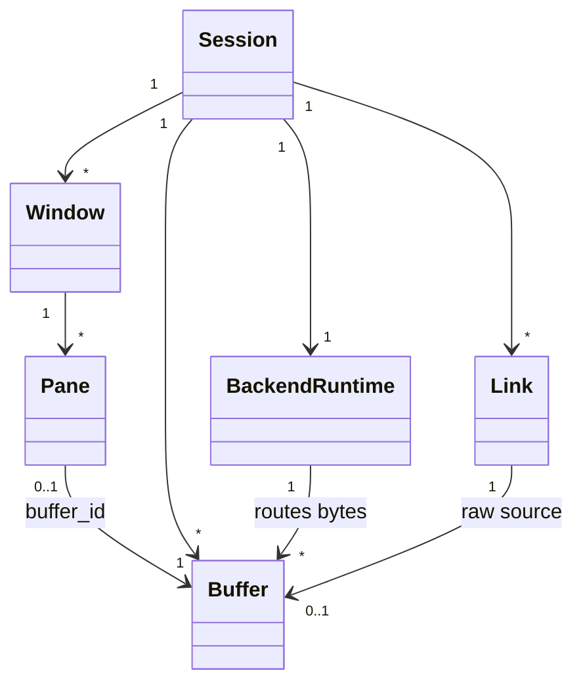
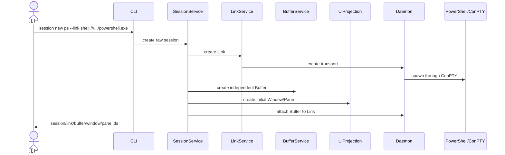
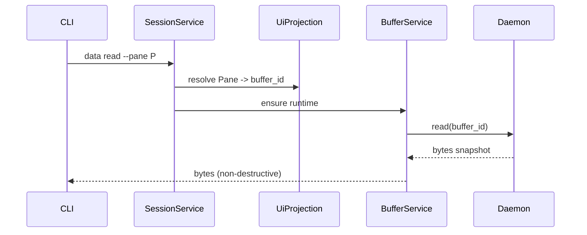
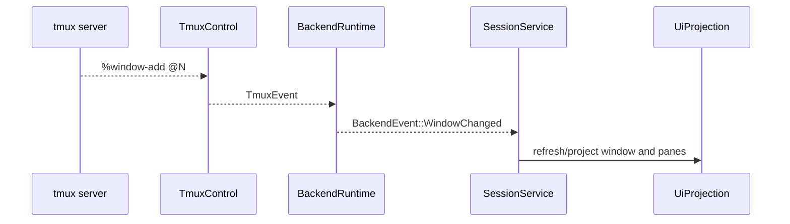

# 逻辑视图

本文采用 4+1 视图中的逻辑视图，描述 xscore 的核心实体、职责边界、协作关系和必须保持的业务不变量。实现细节和目录结构见[开发视图](./view-dev.md)。

## 1. 目标

xscore 把终端工作区拆成两条相互正交的链：

```text
Session -> Window -> Pane -> Buffer
Session -> Link(s) -> BackendRuntime -> Buffer
```

- UI 链只表达布局和视口，不拥有字节。
- 连接链负责传输和协议解释，不拥有布局。
- Buffer 是两条链的汇合点。
- SessionService 负责用例和跨模块事务。
- daemon 是拥有长期连接和 Buffer 内存的独立进程边界。

## 2. 角色与外部系统

| 参与者 | 作用 |
|---|---|
| 用户 | 通过 CLI 创建、查看、操作 Session |
| xscore CLI | 每条命令一个短生命周期进程 |
| xscore daemon | 每个用户配置路径一个长期进程，拥有 live transport、tmux control client 和 Buffer 内存 |
| Shell 子进程 | Bash、PowerShell、pwsh、WSL 等，通过 PTY/ConPTY 运行 |
| tmux server | 本地或远端 tmux 会话宿主，结构的事实来源 |
| SSH 目标机 | native SSH Link 或远端 tmux 所在主机 |
| 串口设备 | `serial://` Link 的字节源 |

## 3. 核心实体



| 实体 | 所有者 | 说明 |
|---|---|---|
| `Session` | SessionService | 工作区，也是 backend 的选择边界 |
| `Window` | UiProjection | UI 布局容器；tmux window 保存 `@N` |
| `Pane` | UiProjection | 纯 UI 视口，保存几何、窗口归属和可选 `buffer_id` |
| `Buffer` | BufferService | 独立字节历史和 runtime |
| `Link` | LinkService | 一条连接；`Pipe` 或 `Control` |
| `BackendRuntime` | SessionService/backend | `RawBackend` 或 `TmuxBackend` |
| `TmuxRuntime` | backend | 进程内 tmux control client 与串行锁 |

具体模型位置遵循“模型跟随所有者”：

- Session 模型在 `service/session_service/model.rs`
- Window/Pane 模型在 `ui/`
- Buffer 模型在 `service/buffer_service/store.rs`
- Link 模型在 `service/link_service/store.rs`
- Link/tmux 目标配置在 `infra/link` 和 `infra/tmux`

## 4. 层与 Service 职责

| 组件 | 负责 | 不负责 |
|---|---|---|
| `SessionService` | 用例、事务、Session 生命周期、backend 选择 | 具体 PTY/SSH/串口/tmux IO |
| `RawBackend` | 多 Link -> 多 Buffer 路由 | 打开具体连接 |
| `TmuxBackend` | 单 control Link、`%N -> Buffer`、tmux event 转换 | 拥有 control client 状态 |
| `TmuxRuntime` | 进程内 tmux client、attach/reconcile 锁 | UI 行持久化 |
| `BufferService` | Buffer registry、ring、runtime、read/write/resize | Pane 布局 |
| `LinkService` | Link registry 和连接生命周期 API | Session 事务 |
| `UiProjection` | Window/Pane CRUD、关联、几何和 orphan 处理 | 字节和连接 |
| `Daemon` | 长期 transport/control client、Buffer 内存、IPC | `state.json` 元数据 |
| `infra` | PTY、ConPTY、SSH、串口、tmux 协议、文件路径 | Session 业务语义 |

## 5. Backend 语义

### RawBackend

```text
Link A (shell)  -> Buffer A
Link B (serial) -> Buffer B
Link C (ssh)    -> Buffer C
```

- 一个 Session 可以有 1..N 个 Link。
- 每个 Link 产生一个独立 Buffer。
- 多个 Pane 可以显示同一个 Buffer。
- 删除 Pane 不删除 Buffer；删除 Buffer 不删除 Link。

### TmuxBackend

```text
one Control Link
  %output %0 -> Buffer for tmux pane %0
  %output %1 -> Buffer for tmux pane %1
  %window-add/%layout-change/%exit -> BackendEvent
```

- 一个 tmux Session 恰好有一个 Link。
- `%N` 是稳定路由键，不是窗口索引。
- tmux 是结构和 pane 生命周期的权威来源。
- `BackendEvent` 被投影为 Window/Pane 行，不直接持有 UI。

## 6. 必须保持的不变量

1. Pane 不保存 Link、transport 或 tmux handle；它只通过 `buffer_id` 引用字节。
2. Buffer 的 `origin` 只能是 `Link { link_id }` 或 `Tmux { link_id, pane_handle }`。
3. Window 和 Pane 必须属于同一个 Session。
4. Raw Session 创建时至少有一个 Link。
5. Tmux Session 创建时自动创建且只创建一个 control Link。
6. 删除 Pane 只删除 UI；删除 Buffer 才结束 Buffer 的生命周期。
7. 删除 control Link 必须经由 `session kill` 或 `session detach`。
8. daemon 不读取也不写入 `state.json`；元数据由 CLI 持有。
9. service 不能依赖 daemon；只能依赖 `DaemonPort` 抽象。
10. UI 的 Window/Pane 行可能滞后于 tmux，下一次结构刷新或事件必须收敛。

## 7. 关键场景

### 场景 A：创建 PowerShell Session



### 场景 B：读取 Pane 数据



### 场景 C：tmux 结构变化



## 8. 非目标

- Pane 不是字节容器，也不是 Link 的所有者。
- Link 不保存 Window/Pane 结构。
- daemon 不是 UI 或 Session 元数据的权威来源。
- service 不直接依赖 daemon 实现。
- xscore 不实现自己的终端渲染器；UI 行目前是 headless 模型。
