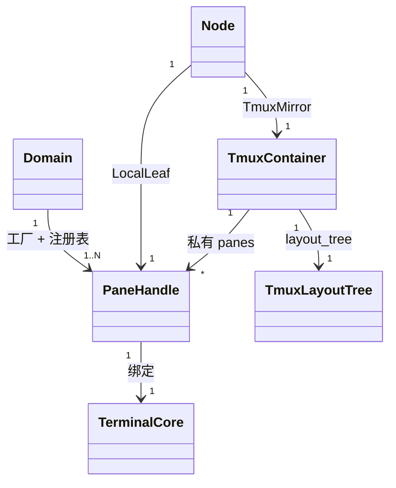
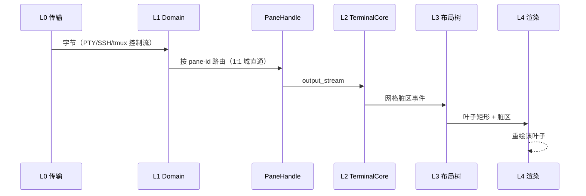
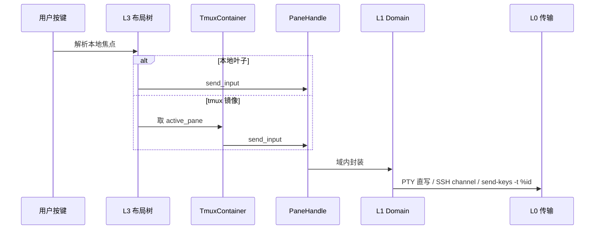
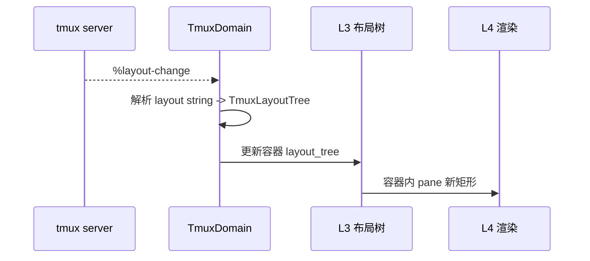
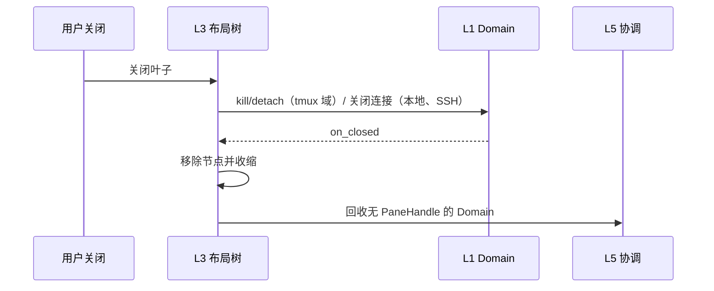

# 逻辑视图

本文采用 4+1 视图中的逻辑视图，描述终端模拟器的核心实体、职责边界、协作关系
和必须保持的不变量。权威模型见 [terminal-emulator.md](./terminal-emulator.md)，
目录结构见[开发视图](./view-dev.md)，进程与数据流见[运行视图](./view-process.md)。

## 1. 目标

本终端模拟器把“连接”与“窗格”拆成两个正交概念，并用六层严格单向依赖组织：

```text
L5 应用/协调 -> L4 渲染 -> L3 组合窗格树 -> L2 终端核心 -> L1 域/连接 -> L0 平台抽象
```

- 连接链（L0/L1）负责 I/O 与协议解释，不负责布局。
- 窗格与布局链（L2/L3）负责屏幕状态与几何，不感知连接类型。
- L1 的 `Domain` 是枢纽：PaneHandle 工厂 + pane 注册表 + 输出路由器。
- 硬约束“tmux pane 不与本地窗格并排”由 L3 的节点类型在结构上保证，不靠运行时
  检查。

## 2. 角色与外部系统

| 参与者 | 作用 |
|---|---|
| 用户 | 通过窗口、快捷键与键盘输入操作终端 |
| 前端（L4/L5，当前模拟） | 渲染、窗口/Tab、焦点、快捷键、全局编排 |
| 后端（L0–L2，本项目实现） | 平台 I/O、Domain 路由、VT 状态机 |
| PTY 子进程 | 本地 Shell、`tmux -CC attach` 控制进程 |
| SSH server | RemoteSshDomain 的远端 PTY channel |
| tmux server | TmuxDomain 的结构与字节事实来源 |

## 3. 核心实体



| 实体 | 所有者 | 说明 |
|---|---|---|
| `Connection` | L1 Domain | 实际 I/O 通道（PTY / SSH channel / tmux 控制 PTY） |
| `PaneHandle` | L1 Domain | 逻辑窗格句柄：绑定模拟核心 + 输入路由 + 输出事件流 |
| `Domain` | L5 DomainRegistry | PaneHandle 工厂 + 注册表 + 输出路由器；Local/Ssh/Tmux 三种实现 |
| `TerminalCore` | L3 叶子 | 每 pane 独立的 VT 状态机 + 网格缓冲区 |
| `Node` | L3 | 本地布局树：Branch / LocalLeaf / TmuxMirror |
| `TmuxContainer` | L3 | 不可拆分的 tmux 布局原子，内部 pane 私有 |
| `TmuxLayoutTree` | L3 容器 | 由 `%layout-change` 驱动，容器内 pane 布局 |

## 4. 层与职责

| 层 | 负责 | 不负责 |
|---|---|---|
| L0 平台抽象 | PTY/ConPTY、子进程、SSH 传输、尺寸原语 | tmux 协议、布局 |
| L1 域/连接 | Connection 抽象、PaneHandle 工厂/路由、tmux 控制协议 | VT 解析、布局几何 |
| L2 终端核心 | 字节 → 网格、VT 状态机、脏区事件 | 连接类型、布局 |
| L3 组合窗格树 | 本地分屏树 + tmux 镜像容器、两级布局与焦点 | I/O、协议、渲染 |
| L4 渲染 | 网格/布局 → 像素、分隔条、字形缓存 | 持有 PaneHandle、协议 |
| L5 应用/协调 | DomainRegistry、焦点、快捷键、配置、生命周期编排 | 协议/VT/几何计算 |

横切设施（事件总线、焦点管理器、生命周期管理器）由 L5 持有并注入，不构成独立层。

## 5. 三种 Domain 语义

### LocalDomain（1:1）

`spawn_pane` 调 L0 `PtyTransport::spawn` 启动 Shell，返回唯一 PaneHandle。输入直写
PTY，输出即 PTY 读流，resize 直调 PTY 尺寸。

### RemoteSshDomain（1:1）

`spawn_pane` 建立 SSH 连接并申请 PTY channel，返回唯一 PaneHandle。输入输出直通
channel，resize 转成 `window-change` 请求。

### TmuxDomain（1:N）

唯一 Connection 是运行 `tmux -CC attach` 的本地 PTY。常驻 reader 解析控制协议：
`%output %id` 按 pane-id 路由到对应 `output_stream`；结构通知更新内部
pane_registry 并广播给 L3；输入为 `send-keys -t %id -H <hex>`；`%layout-change`
解析为 `TmuxLayoutTree` 交给容器持有。

## 6. 必须保持的不变量

1. 依赖严格单向 L5 → L4 → L3 → L2 → L1 → L0，下层不感知上层。
2. L3 只认识 `PaneHandle`，不出现 SSH/tmux 分支。
3. `TmuxContainer` 的内部 pane 只存在于私有 `panes` 映射，不出现在本地 `Node` 枚举。
4. 两套分隔条的几何边界 = 容器整体矩形，互不越界。
5. 尺寸只对容器整体对话；本地不直接对容器内单个 pane 发 resize。
6. `%output` 解码后原样直送 L2，不经 tmux 字符渲染，保证字节保真。
7. 每个 PaneHandle 绑定独立 `TerminalCore`，状态互不共享。
8. 焦点两级：本地焦点遍历本地树；容器内焦点由 `active_pane` 与
   `%window-pane-changed` 驱动。

## 7. 关键场景

### 输出路径



### 输入路径



### 布局变更



### 生命周期（本地关闭叶子）



## 8. 非目标

- 不讨论渲染后端选型（Metal/Vulkan 等）。
- 不讨论配置格式与插件系统。
- 不做运行时校验来补“tmux pane 不与本地窗格并排”——该约束由节点类型保证。
- 后端（L0–L2）不实现布局与渲染。
