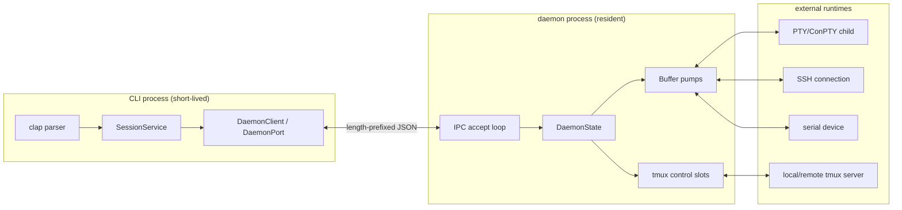
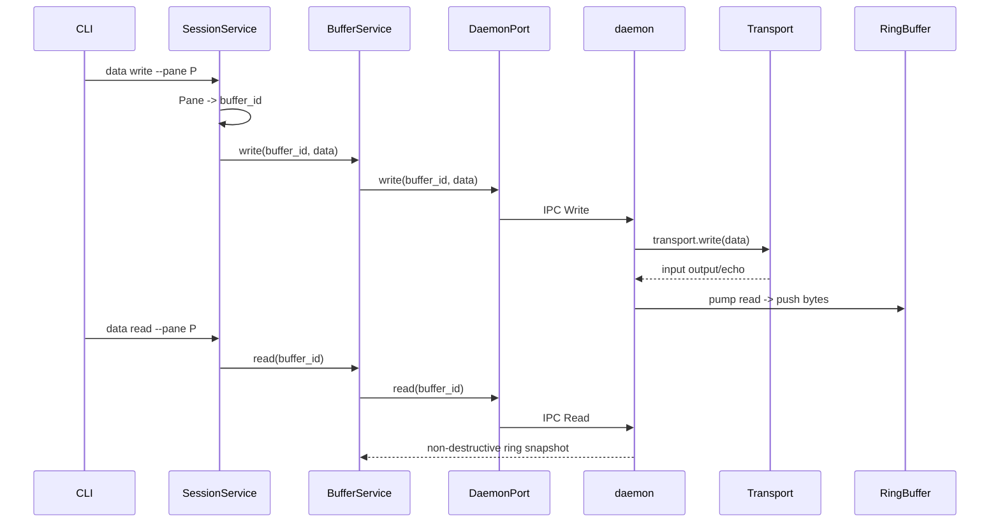
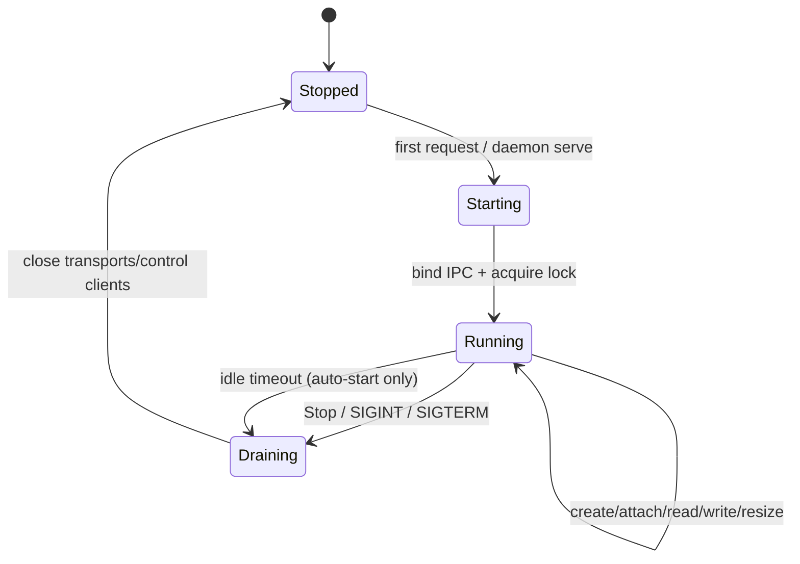

# 运行视图

本文描述进程、线程/异步任务、数据流、并发控制和故障恢复。部署拓扑见[部署视图](./view-deploy.md)。

## 1. 运行单元

### CLI 进程

- 每条命令通常启动一次、执行一次并退出。
- 使用 Tokio runtime；命令解析由 clap 完成。
- 从 `state.json` hydrate 元数据，然后构造 `SessionService`。
- 正常 CLI 路径注入 `DaemonClient`，使 transport 和 Buffer 不随 CLI 退出。
- `daemon serve` 和 `state migrate` 不 hydrate 状态。

### daemon 进程

- 每个配置目录/用户最多一个实例。
- 启动前通过 lock 文件取得单实例权。
- 拥有所有 native transport、tmux control client 和 64 KiB Buffer 内存。
- 不读取 `state.json`，不拥有 Session/Window/Pane 元数据。
- Unix 使用 Unix domain socket；Windows 使用由配置路径派生的 named pipe。
- 自动启动版本带 `--idle-exit`，空闲 5 秒且无 Link/control slot 时退出。
- 用户显式运行的前台 `daemon serve` 默认持续运行，直到 Stop/Ctrl-C/SIGTERM。

## 2. 主要请求的数据流

### Native Link 写入

### Tmux `%output` 路径

1. daemon 为 tmux Session 持有一个 `tmux -CC attach` control client。
2. `TmuxControl` reader 解析 `%output %N <escaped bytes>`。
3. daemon 将 `%N` 映射到 Buffer，并把解码后的字节追加到 ring。
4. CLI 的 `data read` 通过 `DaemonPort` 读取同一个 Buffer 快照。
5. 结构通知通过 `TmuxEvent` 转为 `BackendEvent`，再投影到 Window/Pane 行。

`%output` 在 attach 之后才存在；tmux 不重放历史，因此新 attach 的 Pane 从当前流开始。

## 3. 并发模型

### CLI

- Tokio 主任务执行一个命令。
- state 保存通过 blocking task 写临时文件并原子 rename。
- in-process 模式下，`LocalRuntime` 为每个 Buffer 启动读取任务。
- in-process tmux 模式由 `TmuxRuntime` 保存 control client，并为每个 Pane 输出启动订阅任务。

### daemon

- 主循环接受 IPC 连接；每个连接由独立 Tokio task 处理。
- 每个 native Link 有独立读取 pump，将数据追加到对应 Buffer。
- 每个 tmux Pane 有独立输出订阅任务。
- `tmux_open`、control slot、Buffer slot 和 idle 状态由各自 Mutex 串行化。
- `TmuxControl` 内部有 reader/writer 线程，并通过 channel 与 Tokio 任务通信。
- PTY/ConPTY 的读写由 `portable-pty` 的 reader/writer 完成。

### 主要锁

| 锁 | 保护对象 |
|---|---|
| `SessionService.backends` | SessionId -> BackendRuntime |
| `TmuxRuntime.attach` | 同一 Session 不重复 attach |
| `TmuxRuntime.reconcile` | 结构事件与查询不并发写重复行 |
| `BufferService.runtimes` | BufferId -> runtime |
| `BufferService.memory` | in-process BufferId -> ring |
| daemon `buffers` | native BufferSlot 和 pump |
| daemon `tmux` | SessionId -> tmux ControlSlot |

## 4. 生命周期

- `daemon stop` 关闭所有 transport/control client，清空 Buffer 内存并删除 IPC 端点。
- `link del` 只关闭一个连接，不删除历史 Buffer。
- `session kill` 是逻辑模型的唯一级联删除。
- `session detach` 丢弃 xscore 元数据并停止管理；外部 tmux server 继续运行。

## 5. 故障与恢复

| 故障 | 当前行为 |
|---|---|
| daemon 未运行 | `DaemonClient` 自动拉起；连接失败转为 `Error::Daemon` |
| daemon 重启 | transport 和 Buffer 内存丢失；state.json 保留；可重建 Link transport |
| shell 子进程退出 | native pump 结束，已收到的 Buffer 历史保留 |
| SSH 断开 | native transport/pump 失败；连接状态显示为未连接 |
| tmux control client `%exit` | slot 标记非 alive；Buffer 历史保留；重新 open 后恢复结构 |
| tmux server 消失 | `session attach` 失败；已有 xscore 行可能在后续刷新中清理 |
| 并发 CLI 写 state | 当前策略是 last-writer-wins |

## 6. 数据时效性

- tmux control stream 是实时字节流，不是 `capture-pane` 快照。
- Pane/Buffer read 是非破坏性的 ring copy。
- daemon 重启会丢失内存 Buffer。
- tmux Pane 在订阅前产生的输出不可恢复。
- Window/Pane 结构按事件刷新；CLI 列表操作也会主动重新枚举 tmux。
