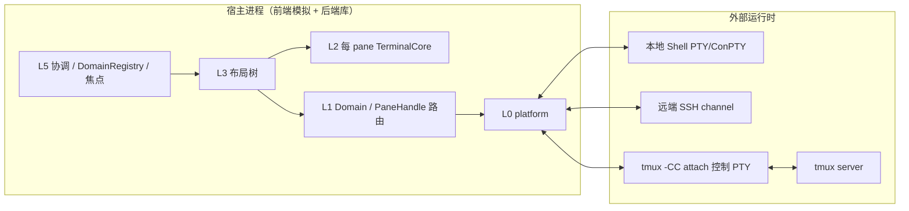
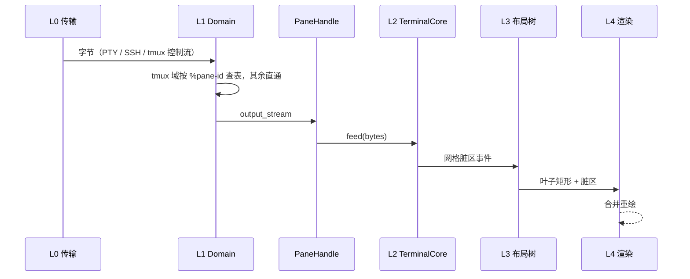
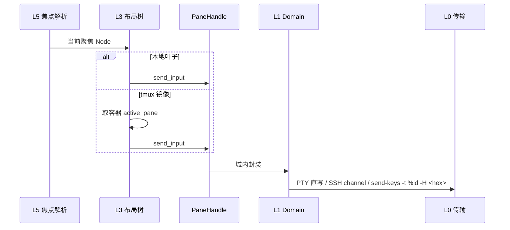
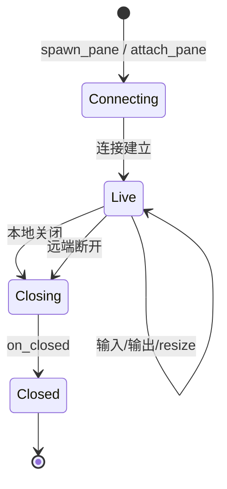

# 运行视图

本文描述进程、异步任务、数据流、并发控制与故障恢复。部署拓扑见
[部署视图](./view-deploy.md)，权威模型见 [terminal-emulator.md](./terminal-emulator.md)。

## 1. 运行单元

后端（L0–L2）以库形式运行在宿主进程中；前端（L3–L5，当前模拟）在同一进程内作
为驱动，负责注入事件与拉取网格快照。

### 后端

- 每个 `Connection` 有一个 reader（PTY reader、SSH channel reader，或 tmux 控制
  流 reader），把字节交给 L1 路由。
- 1:1 域直通；TmuxDomain 的常驻 reader 按 `%pane-id` 查表路由到对应
  `output_stream`。
- 每个 PaneHandle 的 `output_stream` 喂给该 pane 独立的 L2 `TerminalCore.feed`。

### 前端模拟

- 单进程持有 L3 布局树与 L5 协调逻辑。
- 模拟驱动把脚本化的输入写进焦点 PaneHandle，并周期拉取 `GridSnapshot` 输出。
- 不启动真实窗口系统或 GPU 渲染。

## 2. 主要数据流

### 输出路径

### 输入路径

## 3. 并发模型

- 每个 `Connection` 一个 reader 任务；读写独立，避免阻塞读饿死写。
- TmuxDomain 常驻 reader 解析协议，结构通知经事件总线单向流向 L3。
- 每个 PaneHandle 一个 L2 实例，各自维护脏区，互不共享状态。
- L3 的布局变更与渲染读取通过快照/事件同步，渲染不直接持锁长跑。

### 主要同步点

| 同步点 | 保护对象 |
|---|---|
| `DomainRegistry` | domain_id → Domain 实例 |
| TmuxDomain `pane_registry` | `%pane-id` → PaneHandle / output 路由 |
| `TmuxContainer.panes` | 容器内 pane 映射（私有，不暴露给本地树） |
| `TmuxContainer.layout_tree` | `%layout-change` 驱动的内层布局 |
| `TmuxContainer.active_pane` | `%window-pane-changed` 驱动的容器内焦点 |
| L3 本地树 | 节点增删、ratio 更新与收缩 |

## 4. 生命周期

- 本地关闭叶子：L1 发 `kill-pane`/`kill-window`（tmux）或关闭连接（本地/SSH）。
- 远端关闭 pane：`%window-close`/`%layout-change` 触发对应 PaneHandle 的
  `on_closed`，L3 收缩布局或整体移除容器。
- 域在其下所有 PaneHandle 均关闭后由 L5 回收。

## 5. 故障与恢复

| 故障 | 行为 |
|---|---|
| 本地 Shell 子进程退出 | 对应 PaneHandle `on_closed`；已收到的网格历史保留 |
| SSH 连接断开 | 对应 PaneHandle `on_closed`，连接状态标记为断开 |
| tmux control client `%exit` | 容器整体失效；tmux server 本身可继续运行，重 attach 恢复 |
| tmux server 消失 | 容器内 pane 全部 `on_closed`，本地树移除容器 |
| 尺寸竞争 | 本地只对容器整体发 resize，避免对同一 pane 的竞争写 |

## 6. 数据时效性

- tmux `%output` 是实时字节流，不重放历史；订阅前的输出不可恢复。
- L2 网格是内存状态，不承诺持久化。
- `%output` 解码后的原始字节直达 L2，保证 Sixel/OSC 8 等序列保真。
- L4 通过 `GridSnapshot` 拉取或订阅脏区，不直接触碰 I/O。
