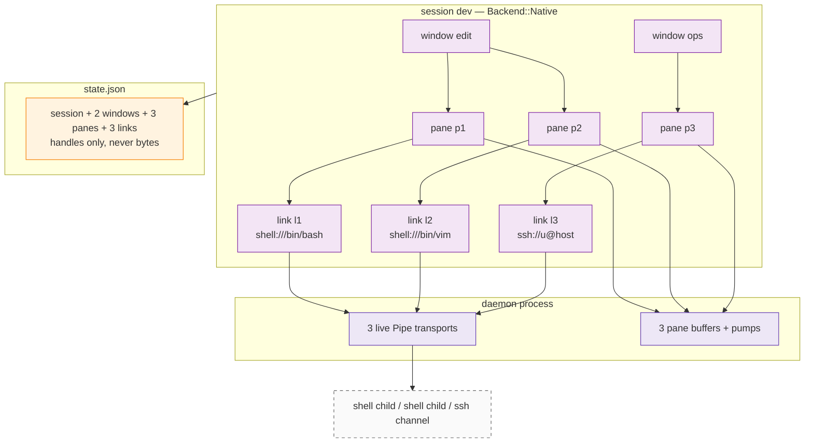
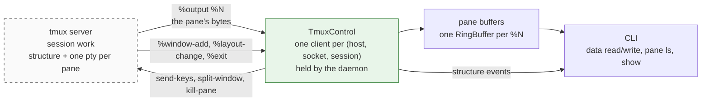
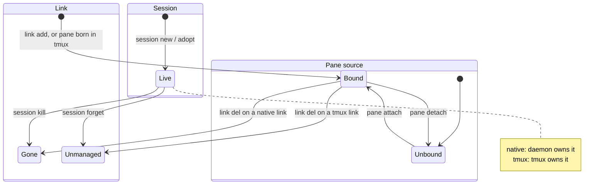
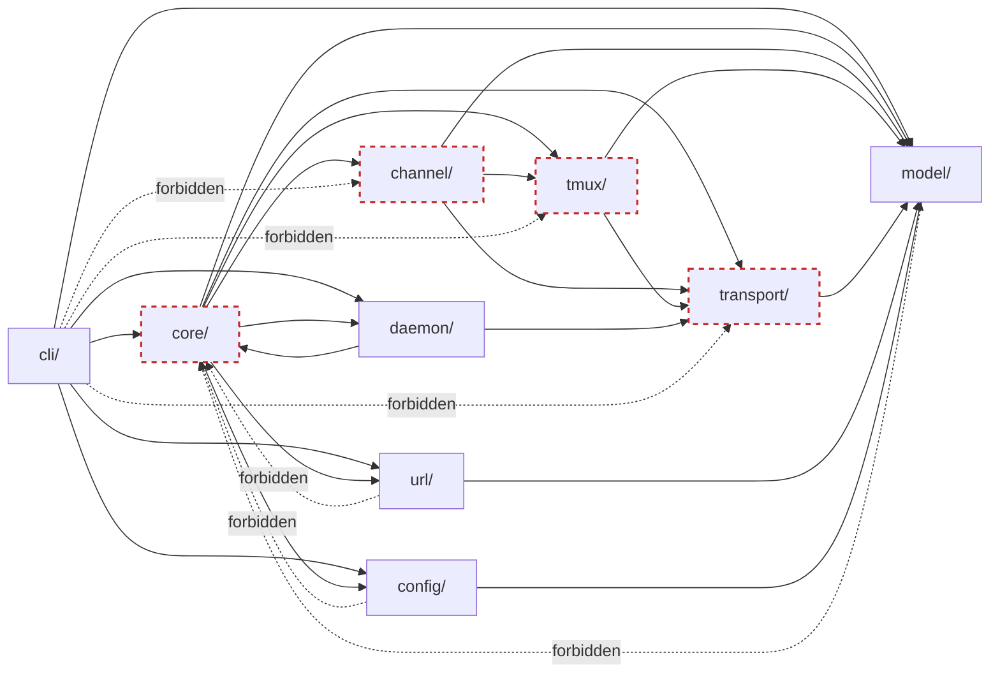

# Architecture — target design

**Status: design only.** This describes the architecture for **v0.6.0**. The
code at `HEAD` is v0.5.1 and does not match it yet — see
[§11 Delta](#11-delta-from-v051) for the gap and the migration.

For the as-built description of v0.5.1:

```bash
git show v0.5.1:doc/dev/arch/arch.md
```

This file is the shape, not the argument. Rationale lives in the ADRs:

| ADR | Owns |
|---|---|
| [0001](../adr/0001-link-pane-model.md) | Link / Window / Pane as addressable tiers |
| [0002](../adr/0002-transport-sink-split.md) | Transport vs Sink split — *Sink is retired by this design* |
| [0003](../adr/0003-external-tmux-server.md) | External tmux, never embedded |
| [0005](../adr/0005-add-open-close-del-verbs.md) | Verb semantics — *`open`/`close` move to `session`* |
| [0006](../adr/0006-window-concept.md) | Window tier |
| [0007 v2](../adr/0007-raw-default-tmux-opt-in.md) | Decoupled entities, buffer-per-pane, Q1/Q2 |
| [0008](../adr/0008-tmux-adoption.md) | tmux is the source of truth; `@N` / `%N` anchors |
| [0009](../adr/0009-daemon.md) | Resident daemon owns native transports and buffers |

## 0. The model in one screen

A **session is a workspace with a backend**. The backend decides who keeps the
processes alive and who owns the structure:

```
Session ── workspace; 1:1 with a tmux session, or standalone
  ├ Window ── layout container
  ├ Pane   ── buffer + geometry
  └ Link   ── one connection (an endpoint)
```

| | `Backend::Native` | `Backend::Tmux { .. }` |
|---|---|---|
| keeps processes alive | the resident daemon | the tmux server |
| where it runs | this machine | this machine, or an ssh host (§6) |
| Window | xscore grouping; no layout engine | mirrors a tmux window (`@N`) |
| Pane | xscore buffer + geometry | is a tmux pane (`%N`) |
| Link endpoint | `Pipe` — xscore owns the pty/device/channel | `TmuxPane` — a control client feeds it |
| who feeds the pane buffer | the daemon's pump | `%output` from the control client |
| survives CLI exit | yes (daemon) | yes (tmux) |
| attach a human | n/a | `exec tmux attach` |
| multi-client | no | yes |

That table is why `Session` exists. "Does this go through tmux?" was never a
property of a *link*; it is a property of the *workspace* the link lives in.

### A session is a container, not a viewport

Both backends hold **N windows, each with N panes, each pane bound to at most
one link**. Cardinality is not what separates them — ownership is.

```
session dev                                  (Backend::Native)
├── window "edit"
│   ├── pane p1 ── link l1   shell:///bin/bash
│   └── pane p2 ── link l2   shell:///bin/vim
└── window "ops"
    ├── pane p3 ── link l3   ssh://u@host
    └── pane p4 ── link l4   serial:///dev/ttyUSB0

session work                                 (Backend::Tmux { session: "work" })
├── window @0
│   ├── pane %0 ── link l5
│   └── pane %1 ── link l6
└── window @1
    └── pane %2 ── link l7
```

```
Session 1:N Window      Window  1:N Pane       Pane 0..1 Link   (unbound = history only)
Session 1:N Link        Session 1:N Pane       Link 0..1 Pane   (serves at most one)
```

A native session is a *workspace*, not a single shell: it can hold several
windows, several panes, and links of **mixed kinds** at the same time (shell +
ssh + serial in one workspace is a normal case). A tmux-backed session gets the
same multiplicity from tmux, which additionally owns the layout.

`session new` creates initial content so the common path stays one step — one
window plus one link and one pane, mirroring what tmux does — but that is a
convenience, not a limit. Grow it with `window new`, `link add`, `pane new`.

## 1. Session

```rust
pub struct SessionInfo {
    pub id: SessionId,
    pub name: String,
    pub created_at: DateTime<Utc>,
    pub backend: SessionBackend,
}

pub enum SessionBackend {
    /// Links are byte pipes owned by the daemon; windows are xscore's own
    /// grouping. Dies when the daemon forgets it.
    Native,

    /// This session IS a tmux session. Windows and panes are read from tmux;
    /// xscore stores only the handles it adopted.
    Tmux {
        /// This machine, or an ssh host. Defined in §6.
        host: TmuxHostConfig,
        /// Which tmux server on that host. Resolved *on that host*, so a named
        /// socket is a different file on a different machine. Defined in §6.
        socket: TmuxSocket,
        /// tmux session name. Deliberately NOT derived from SessionId:
        /// tmux sessions are user-visible and user-nameable.
        session: String,
    },
}
```

`Backend::Tmux` is the 1:1 correspondence held as a **pointer, not a mirror**.
xscore does not keep a second copy of tmux's structure that could drift; when a
command touches a tmux-backed session it reads that session's **live** state
from its control client (see §7), which pushes changes as they happen.

## 2. Window

```rust
pub struct WindowInfo {
    pub id: WindowId,
    pub session_id: SessionId,
    pub name: String,
    pub created_at: DateTime<Utc>,
    pub backend: WindowBackend,
}

pub enum WindowBackend {
    /// xscore-side grouping. Panes inside are a list; there is no renderer,
    /// so there is no layout to describe.
    Native,
    /// Mirrors a tmux window. Layout is read from tmux on demand
    /// (`#{window_layout}`) and never stored.
    Tmux { handle: String },   // "@N"
}
```

**`WindowLayout` is deleted.** It was a five-variant enum (`single`, `tabs`,
`split_h`, `split_v`, `grid`) with zero consumers: tmux owns layout for tmux
windows, and nothing renders native ones. A stored layout hint nobody applies
reads like a feature. When a UI layer exists it can introduce a layout model
shaped by what that layer actually needs.

## 3. Pane

A pane is a **buffer with a viewport** — the unit users read and write.

```rust
pub struct PaneInfo {
    pub id: PaneId,
    pub session_id: SessionId,
    pub name: String,
    pub created_at: DateTime<Utc>,
    pub cols: u16, pub rows: u16,      // size
    pub x: u16,    pub y: u16,         // position inside its window
    pub window_id: Option<WindowId>,   // None = not displayed
    pub link_id: Option<LinkId>,       // None = no source; history only
    pub backend: PaneBackend,
}

pub enum PaneBackend {
    Native,
    /// This pane IS tmux pane `%N`. Its identity is the handle: it cannot be
    /// re-bound to another link, and it dies with its tmux session.
    Tmux { handle: String },
}
```

The pane's **bytes are not in `PaneInfo`** — it is rewritten on every geometry
change and every save, and a 64 KiB scrollback is neither. The bytes live beside
the channel:

- native pane → `RingBuffer` (64 KiB) in the daemon (or in-process in tests).
  Survives `detach`; read is a non-destructive snapshot.
- tmux pane → the same `RingBuffer`, fed by `%output` from the control client.
  tmux additionally keeps its own scrollback, reachable with `capture-pane`.

## 4. Link and Endpoint

A link is **one connection**: a handle you can list and hand to at most one pane.

```rust
pub struct LinkInfo {
    pub id: LinkId,
    pub session_id: SessionId,
    pub name: String,
    pub created_at: DateTime<Utc>,
    /// The tmux session is implied by `session_id` (`SessionInfo::backend`),
    /// so a session rename can never leave a stale name here.
    pub endpoint: EndpointRef,
}

pub enum EndpointRef {
    /// shell / serial / ssh: xscore owns the pty, the device or the channel.
    Pipe(TransportConfig),
    /// A pane in this session's tmux server. xscore owns nothing: it holds a
    /// control-mode client and receives the pane's bytes from it.
    TmuxPane { pane: String },   // "%N"
}

// Runtime, never serialized:
pub enum Endpoint {
    Pipe(Arc<dyn Transport>),
    TmuxPane { control: Arc<TmuxControl>, pane: String },
}
```

### A tmux pane is a stream, not a screen

Earlier drafts called this endpoint `Screen`, on the grounds that `capture-pane`
returns a rendered grid and there is no byte stream. That is true of
`capture-pane` and **false of tmux**. Control mode streams every byte the pane's
pty produces (measured on tmux 3.5a):

```
%output %0 TICK\015\012
%output %1 \033[?2004hloner@WinLite \033[0;36mxscore\033[0m $ 
%output %0 \015\033[K\015HELLO\015\012
```

`\ooo` is an octal byte, `\\` a literal backslash. So a tmux pane carries
**terminal bytes**, the same shape as reading a pty. What differs:

- **who owns the pty** — tmux, not xscore;
- **the framing** — one `%output` notification per write, escaped;
- **no replay** — output produced before the client attached is not re-sent.
  History exists only as scrollback, reachable with `capture-pane -S -`.

That last point makes `capture-pane` a *different verb*, not the read path:
"show me the rendered screen" rather than "give me the bytes".

### Every link is exclusive

Q1 ("a direct link serves one pane at a time") stops being a special case and
becomes the only rule: **a link is handed to at most one pane**. Multi-pane is a
*backend* capability — `Backend::Tmux` gives you N panes by giving you N links,
one per tmux pane.

That is also why `Sink` is retired (§11): `capacity` / `grant` / `revoke` only
existed to express "this link may be shared", and after this change nothing may.

### Who owns the stream

Four mechanisms, one shape:

| link | who owns the stream | `read` returns | `resize` means |
|---|---|---|---|
| `serial://` | xscore, a device fd | device bytes | nothing (no size) |
| `shell://` | xscore, a **pty** | terminal bytes | `TIOCSWINSZ` |
| `ssh://` | xscore, a TCP socket + SSH channel | channel bytes | channel `window-change` |
| tmux pane | **tmux** | terminal bytes via `%output` | `resize-pane` |

The uniform shape is the point: every endpoint produces bytes into the pane's
`RingBuffer`, so `data read` has one implementation. What varies is only who
owns the underlying stream and how a write is encoded (`pty write` vs
`send-keys`).

Two rules follow:

1. **A shell link must allocate a pty.** With a plain pipe the child
   block-buffers stdout, `isatty` is false, and echo, job control and
   `SIGWINCH` are gone: `vim`, `sudo`, `python -i` all take their
   non-interactive path. A session manager for shells that cannot run an
   interactive program is not one.
2. **`resize` must not lie.** It is real only where someone owns a size. A
   serial link has none, so the call must fail explicitly instead of returning
   ok and storing numbers in `PaneInfo`.

### What a link is not

- not a tmux session (a session is a session)
- not a pane (a pane consumes a link)
- not an owner of windows or panes

## 5. Runtime topology

Both pictures below are *structure*, not call sequences — the point is that a
session holds many windows, many panes and many links.

### Native session



### tmux-backed session



When the server is across ssh (§6) there is one extra segment on the same
bidirectional edge — `ssh <dest>` — and nothing else changes.

The difference between the two pictures is the whole design: **both backends end
in a pane buffer**, so `data read` is one implementation. Native differs only in
that xscore owns the pty; tmux differs only in that a control client feeds the
buffer and pushes structure events instead of us polling for them.

## 6. tmux over SSH

A tmux server may be reachable only from another machine. Since §4 established
that a session is fed by **one long-lived control client**, remote is one extra
segment in that client's command, not a second mechanism:

```
ssh -o BatchMode=yes <args...> <destination> tmux -L <sock> -C attach -t work
```

stdin and stdout of that `ssh` process are the control channel. Control
commands go in as lines; `%output`, `%begin/%end` and every notification come
back on the same channel. One connection per managed session, in both
directions.

`-C` rather than `-CC`: `-CC` additionally disables the terminal echo that only
exists when the client has a tty, and a pipe-based client has none. (Verified on
3.5a: `tmux -C attach` works with stdin/stdout as pipes.)

### Why this is not the `ThroughTransport` mistake

An earlier draft rejected running tmux commands through a `Transport`, because a
raw stream carries prompts, banners and partial writes, and carving one command's
output out of it requires a parser we would have to invent and then keep
correct.

Control mode is the opposite case. The framing already exists and is part of
tmux's interface: `%begin <ts> <num> <flags>` opens a command's reply, `%end` /
`%error` closes it, and `%output`/`%layout-change`/… live in a separate
namespace. We parse a protocol tmux defines rather than guessing where output
stops. The rule that survives is narrower and still true: **do not multiplex
command control over a stream that has no framing of its own.**

### Two exec shapes, on purpose

| what | how | why |
|---|---|---|
| a **managed** session (we hold its control client) | one persistent `tmux -C attach` (locally, or through one `ssh`) | streams bytes and pushes events |
| **enumeration and one-shot** (`session ls` across hosts, probing, `adopt`, `kill` of a session we are not attached to) | one `tmux <cmd>` exec per call (`ssh <dest> tmux ...`) | request/response, no state to keep |

Mixing them up is the bug to avoid: data must never go through a one-shot exec
(nothing to stream from), and enumeration must never require attaching (that
would leave a client per session just to list names).

### Escaping has one layer here, not two

With a one-shot `ssh <dest> tmux send-keys ...`, `ssh` joins its argv and hands
the string to the **remote shell**, so a payload is parsed twice and large
payloads hit `ARG_MAX`. On the control channel there is no shell: the line goes
straight to tmux's own command parser, so a write is

```
send-keys -t %0 -l '<text escaped for tmux>'
```

Measured: `;`, `"`, `$` and backticks all arrive literally inside `-l` quotes.

Two limits remain and are not fixable at this layer:

- **NUL cannot be sent.** The protocol is line-oriented; a byte stream carrying
  `\0` has no representation. Anything needing it is not a tmux link.
- **tmux escaping is still real.** A payload with `'`, `\` or a newline must be
  quoted for tmux's parser, and getting it wrong is a silent mis-type rather
  than an error. This is the one place where "escape once, exactly" has to be
  written and tested rather than assumed.

### Credentials

xscore stores **no** SSH credentials. It execs the system `ssh`, so
`~/.ssh/config`, `ProxyJump`, agent forwarding and `Match` blocks all apply —
none of which the `russh`-based `ssh://` link path reads, because that client is
driven by a `TransportConfig`. Two jobs, two mechanisms:

| | how it connects | why |
|---|---|---|
| `ssh://` link | `russh`, from `TransportConfig` | xscore needs the shell's *bytes* |
| tmux session over ssh | system `ssh`, one control channel | xscore needs the user's identity and config |

`BatchMode=yes` is mandatory: a password or host-key prompt would block a
non-interactive CLI forever. Failing fast is correct — a first-time host is
trusted once, by the user, in a real terminal. `ConnectTimeout=5` bounds the
other hang. Connection reuse is not needed the way it was for per-command execs;
there is one connection per session by construction.

### Failure semantics

| what happened | signal | error | rows |
|---|---|---|---|
| session killed | `%exit` on the control channel | `TmuxTargetGone` | prune that session |
| ssh dies, times out, or auth fails | channel EOF / exit 255 on a one-shot | `TmuxUnreachable { host }` | **prune nothing** |
| one-shot tmux error | exit 1–254 | `TmuxTargetGone` | prune that row |

The second row is load-bearing: **an unreachable host must never delete rows.**
A laptop on a train would otherwise forget every remote session it manages, and
the next `ls` would report a workspace that still exists.

### Listing is local, showing is live

`session ls` never touches the network: it prints what `state.json` knows plus a
`HOST` column, so listing ten sessions across three hosts is instant and works
offline. `session show`, `attach`, `data` and window/pane mutations use the live
control client (or a one-shot exec when the session is not managed). `ls
--refresh` opts into a network pass.

### Naming

Two machines can each have `work`. The key is `(host, socket, session)`;
`SessionId` is the stable identity. The CLI reference is `name` when
unambiguous, `<host>/<name>` otherwise (`devbox/work`, `local/work`).

### Attach

```
ssh -t <dest> tmux -L <sock> attach -t work
```

exec'd in place of `xscore`. The remote TTY, resize and `Ctrl-b` belong to tmux
exactly as if the user had typed that command; xscore is out of the loop and
holds no connection.

### Testing without a network

`TmuxHost` is an argv prefix: `[]` locally, `["ssh", "-o", "BatchMode=yes", ...]`
remotely. Tests substitute the prefix, so a fake `ssh` (exits 255) and a fake
`tmux` cover the remote paths. A real control-mode transcript captured from
tmux 3.5a is the parser's fixture.

## 7. Events, not polling

There is no refresh pass and no sync command. A managed tmux session has a
control client attached, and that client pushes everything:

| notification | meaning | what xscore does |
|---|---|---|
| `%output %N <escaped>` | pane bytes | append to `%N`'s RingBuffer |
| `%window-add @N` | window appeared | insert `WindowInfo` |
| `%window-close` / `%unlinked-window-close @N` | window gone | delete it and its panes |
| `%window-renamed @N` | rename | update `name` |
| `%layout-change @N <old> <new> <flags>` | geometry | update pane sizes |
| `%session-window-changed $N @M` | current window | update a `active` flag |
| `%session-changed`, `%sessions-changed` | session set | update `SessionInfo` |
| `%exit [reason]` | client detached / session over | detach; prune if the session is gone |

Parser rules, both learned from real output rather than documentation:

- **Route by prefix, not by position.** `%begin <ts> <num> <flags>`, the
  command's output lines, then `%end` (or `%error`) form one block; events may
  arrive *inside* a block. A parser that assumes "anything between begin and end
  is output" breaks the first time a window appears while a command runs.
- **Ignore unknown `%` lines.** tmux renames notifications across versions —
  3.5a emits `%unlinked-window-close` where older releases emitted
  `%window-close`. Unknown notifications are skipped, never fatal.

Consequences of this being event-driven:

- no `refresh`, no `--heal`, no global pass, no geometry polling;
- `%exit` distinguishes "session gone" from "host unreachable" without exit-code
  guesswork;
- a detached pane keeps its buffer (§3) and `data read` still returns what
  arrived before the detach, but nothing new arrives until a client re-attaches.

`capture-pane` remains available as an explicit screen query (`pane screen`),
because "the last 200 lines as rendered" and "the bytes since I last looked" are
different questions and both are legitimate.

## 8. Lifecycle and invariants



Invariants and what enforces each:

- **A link serves at most one pane.** Per-session scan on attach; no other
  capacity exists.
- **A pane's link is in the same session.** Cross-session moves only via an
  explicit `pane move --session`, never as a side effect of `attach`.
- **A tmux pane cannot be detached.** `PaneBackend::Tmux` is its identity;
  `pane detach` refuses. Destroying it is `pane kill`.
- **A tmux handle is never an index.** `@N` / `%N` only — indices shift on
  rename and reorder.
- **Binding ≠ liveness.** `pane show` reports `link_id`; `link show` reports
  `connected` (probed from the daemon for native links). A native link whose
  transport died — the daemon exited or restarted — keeps its binding and loses
  its connection → `LinkNotConnected`, never `NotAttached`.
- **Killing a session is the only cascade.** It removes its windows, panes and
  links and nothing else.
- **`link del` on a tmux link forgets the handle.** The tmux pane and its
  session survive: a handle is not an owner. To destroy tmux state use
  `pane kill` / `session kill`.
- **`session forget` leaves the backend running.** Drops xscore's rows only
  (tmux-backed sessions; for native it is equivalent to `kill`, because the
  daemon is the backend).

## 9. Module structure (target)

```
crates/xscore/src/
  core/        ids, error, address, session, link, pane, window, registries,
               manager, state, buffer (RingBuffer), events
  model/       SessionInfo, LinkInfo, WindowInfo, PaneInfo,
               SessionBackend, WindowBackend, PaneBackend, TransportConfig
  channel/     Channel trait, PipeChannel, TmuxPaneChannel, DaemonChannel
  transport/   Transport trait, shell, serial, ssh, NoopTransport, DaemonTransport
  tmux/        TmuxHost (Local / Ssh), TmuxControl (control-mode client),
               event decoding, session runtime
  daemon/      protocol, server, client
  url/         URL parser
  config/      link templates
  cli/         session, window, pane, link, data, daemon
```

`backends/` disappears: it held the conduit (`PaneBridge`) and the pane's buffer.
The conduit becomes `channel/`; the buffer moves to `core/buffer.rs` because it
belongs to the pane, not to the connection.



Two notes that survive from v0.5.1:

- `core ↔ daemon` is the one tolerated cycle: `core` holds a `DaemonClient`
  field and the client needs `Error` / ids. Tolerable while the back-edge only
  touches those leaf types; if it grows, extract a `LinkStore` trait into
  `core`.
- `daemon/server` is reachable only from `main.rs` (`daemon serve`), never from
  `core`. That keeps "run in-process" and "run as a server" from collapsing into
  one path.

## 10. Command surface

```bash
# Session — the workspace
xscore session ls [--all] [--host H] [--refresh]
xscore session new <name> [--tmux [--ssh DEST] [--socket S]] [--empty]
                          [--cmd C] [--cwd D] [--cols N --rows N]
xscore session adopt <name> [--ssh DEST] [--socket S]   # take over an existing tmux session
xscore session show <ref>                    # its windows / panes / links
xscore session attach <ref>                  # tmux: exec tmux attach; native: unsupported
xscore session kill <ref>                    # destroy the backend and the rows
xscore session forget <ref>                  # drop xscore rows, leave backend running
xscore session rename <ref> <new>

# Window — scoped to a session
xscore window ls   --session <s>
xscore window new  --session <s> [--name N] [--cmd C] [--cwd D]
xscore window kill <w>
xscore window rename <w> <new>

# Pane — scoped to a session
xscore pane ls   [--session <s>] [--window <w>]
xscore pane new  --session <s> [--window <w>] [--cmd C] [--cwd D] [--cols N --rows N]
xscore pane kill <p>
xscore pane attach --pane <p> --link <l>     # native only
xscore pane detach --pane <p>                # native only
xscore pane move   --pane <p> --window <w>   # within the session
xscore pane screen <p> [--history N]         # rendered grid via capture-pane, not bytes

# Link — native sessions
xscore link add <url> --session <s>
xscore link ls  [--session <s>]
xscore link del <l>

# Data — any pane
xscore data read  --pane <p> [--bytes N]
xscore data write --pane <p> [< file | --from-file F]
xscore data resize --pane <p> --cols C --rows R
```

Notes:

- `<ref>` is a session `name`, or `<host>/<name>` when that name exists on more
  than one host (`devbox/work`); `local/<name>` is always accepted. Two machines
  can each have `work`, so names are not globally unique — see §6.
- Every `<ref>`-taking verb resolves the host first and then contacts only that
  host. No command ever fans out across hosts.
- `--cmd` / `--cwd` belong to the verbs that **start a process** (`session new`,
  `window new`, `pane new`). URLs only say how to connect. This is where the
  command that v0.5.1 silently dropped (`?tmux=on` ignored the URL's command)
  now lives.
- `session new` starts the workspace with **one window, one link, one pane**
  so the common path stays a single command. `--empty` skips that for a native
  session (bare workspace); it is a no-op for `--tmux`, where tmux always
  creates at least one pane.
- `session new` creates a *workspace*, not one viewport. A native session can
  hold several windows and links of mixed kinds (shell + ssh + serial) at the
  same time — see §0.
- For a tmux session, `pane new` is atomic: `split-window`, adopt `%N`, create
  the link, bind them. A tmux pane is born bound.
- `session attach` replaces `link open`; `session kill` / `session forget`
  replace `link close`. `link` loses both verbs.
- `?tmux=on|auto|local|remote` is **removed**. Whether a session is tmux-backed
  is decided at `session new` / `session adopt`.
- `tmux://` is **not** a link URL. Adoption happens at the session level.

## 11. Delta from v0.5.1

### Removed

| Gone | Why |
|---|---|
| `Sink` trait, `RawSink`, `TmuxSink: Sink` | no link may be shared, so `capacity` / `grant` / `revoke` have nothing to express |
| `Link.sink: Box<dyn Sink>` | it was dead: one `no-op attach` call, then never touched |
| `Link.active_pane` (Q1 ledger) | exclusivity follows from "one link, one pane" |
| `SinkConfig::{Raw, Tmux}` | replaced by `SessionBackend`; a link no longer knows about tmux |
| `?tmux=on\|auto\|local\|remote` | tmux-ness is a session property |
| `socket: Option<String>` | replaced by `TmuxSocket { Default, Named, Path }`: a named socket resolves on the *host*, so a name is not a location |
| `WindowInfo.tmux_window_handle`, `PaneInfo.sink_handle` | folded into `WindowBackend::Tmux` / `PaneBackend::Tmux` |
| `WindowLayout` (5 variants) | no consumer; tmux owns layout, native has no renderer |
| `link open` / `link close` | `session attach` / `session kill` / `session forget` |
| `link sync [--heal]` | replaced by control-mode events (§7): no mode flag, no global pass, no polling |
| `backends/` module | split into `channel/` (the conduit) and `core/buffer.rs` |

### Added

| New | Role |
|---|---|
| `Session` + `SessionId` + `SessionBackend` | the workspace, and who keeps it alive |
| `Endpoint::{Pipe, TmuxPane}` | who owns the stream: xscore, or tmux through a control client |
| `channel/{Pipe,TmuxPane,Daemon}Channel` | what a pane reads and writes through |
| `tmux::TmuxHost` (`Local`, `Ssh`) | argv-prefix runner: local `tmux`, or `ssh <dest> tmux` once per command (§6) |
| `session adopt` / `session forget` | manage sessions xscore did not create; stop managing without destroying |
| `pane new --window` on a tmux session | creates tmux pane + link + pane atomically |

### Changed

| Area | v0.5.1 | v0.6.0 |
|---|---|---|
| state schema | v2: flat `links`/`windows`/`panes` | **v3**: adds `sessions`; every child carries `session_id`; backends replace `sink` / `sink_handle` / `tmux_window_handle` |
| `link add` | no session | requires `--session` (a native session) |
| Q1 | special case in `attach_pane` | universal: one link → one pane |
| tmux control | `Sink` methods + `link sync` + one exec per call | one control client per session; notifications update state (§7) |
| remote tmux | `?tmux=remote`, never read — always local | `SessionBackend::Tmux { host: Ssh { .. } }`; one `ssh` exec per tmux command |
| `Window.layout` | stored enum | gone; `#{window_layout}` read from tmux when needed |

### Behaviour that must change (defects, not features)

These are wrong in v0.5.1 and are not optional for v0.6.0:

| today | why it matters | v0.6.0 |
|---|---|---|
| `ShellTransport` uses `Stdio::piped()`, not a pty | child block-buffers stdout; no `isatty`, echo, job control or `SIGWINCH`; TUIs and `sudo` misbehave | allocate a pty, set `TERM` (§4) |
| `portable-pty` is a declared dependency with **zero uses** | dead weight; the pty path was intended and never finished | used by the shell side of `PipeChannel` |
| `data resize` on a direct pane returns ok and does nothing | a silent lie: the caller sees success | `TIOCSWINSZ` / `window-change` / `resize-pane`, else an explicit error (§4) |
| `ShellTransport` holds **one** mutex across `read` and `write` | a blocking read starves writes; the 10 ms poll and `spawn_blocking` are workarounds, and `data write` can stall behind a queued read | split the pty into independent read and write halves |

### Migration (v2 → v3)

`schema_version: 3`; v2 files are rejected with an actionable error, not
silently converted (same policy as v0.4.0). The one-time migration:

1. each existing tmux link → `Session { backend: Tmux { socket, session } }`
   named after the link; its `@N` / `%N` handles move into the child backends.
2. each existing native (raw) link → `Session { backend: Native }` named after
   the link; its pane keeps the binding.
3. windows and panes are re-parented to the session they came from.
4. `link sync` output is discarded — it described cached structure that is now
   event-driven.

## 12. Open decisions

| # | Question | Lean |
|---|---|---|
| D1 | Does a tmux-backed session have explicit `Link`s (1:1 with panes), or do panes hold a `TmuxPane` endpoint directly? | **Explicit links.** One binding rule ("a pane uses a link") beats two, and it is where exclusivity lives. Cost: a 1:1 link that can never be re-bound. |
| D2 | Window mirroring for tmux sessions: mirror `@N`, or keep one tmux window and treat xscore windows as private? | **Mirror `@N`.** `tmux attach` must show what xscore shows, or the product premise breaks. |
| D3 | `WindowLayout`: delete for good, or keep a hint for native windows? | **Delete.** No consumer; reintroduce with the renderer. |
| D4 | tmux socket: private `-L xscore`, or the user's default socket? | **Default socket**, `--socket` to override. Sessions invisible in `tmux ls` are not "managed". Tests pass `--socket` explicitly. |
| D5 | `link del` on a tmux-backed link | **Forget the handle only.** A link is a view, not an owner. |
| D6 | Can a pane move between sessions? | **No implicit moves.** `pane move --session` is explicit and native-only. |
| D7 | `session forget` — needed, or is `kill` enough? | **Keep it.** Mirrors v0.5.1's `del` vs `close`: destroy vs stop managing. |
| D8 | Alternative to mirroring: address tmux directly (`data --tmux work:1`) and have no xscore rows for tmux at all | **Rejected for now**, because it gives two addressing modes for `data`. Revisit if the control-client model proves troublesome. |
| D9 | Does xscore pass `ControlMaster=auto` by default, or only when the user asks? | **Pass it**, overridable via `--ssh-arg`. Without it a burst of commands pays a full handshake each time; with it xscore writes no pooling code. |
| D10 | Should `ssh://` links move to the system `ssh` too, leaving one SSH mechanism? | **Not in this change.** `russh` gives a byte stream and in-process control; a link is not an exec client. Revisit only if storing password auth becomes a liability. |
| D11 | Is control mode the only tmux integration, or do one-shot execs stay? | **Both, split by job** (§6): a control client for a managed session, one exec for enumeration. |
| D12 | `-C` or `-CC`? | **`-C`.** `-CC` only disables terminal echo, which a pipe client does not have. |

## 13. What this does not solve

- **tmux output is line-framed.** `%output` is escaped text on a line protocol,
  so `\0` cannot be sent and arbitrary binary is unsafe. It is terminal bytes,
  not any bytes.
- **No replay.** Attaching a control client does not re-send earlier output;
  history exists only as scrollback (`capture-pane -S -`).
- **No exit status from a pane.** Liveness arrives as a pane-dead flag, not as a
  `waitpid` status.
- **No renderer.** Native windows have no layout model and no drawing code;
  `pane.cols/rows/x/y` are recorded but unenforced. The tmux backend is the only
  one that can display anything to a human today.
- **Remote tmux is designed, not implemented.** §6 is the contract; local tmux
  ships first, `TmuxHostConfig::Ssh` follows without changing the model.
- **No remote *native* sessions.** A `Backend::Native` session lives on this
  machine, because its links are owned by the local daemon. "A shell on another
  host" is an `ssh://` link inside a local session, not a remote session.
- **Concurrent `state.json` writers still last-writer-wins.** Unchanged from
  v0.5.1. Sessions shrink the blast radius (mutations are scoped) but add no
  locking.
- **Daemon idle exit still drops native pane buffers** (they are not persisted).
