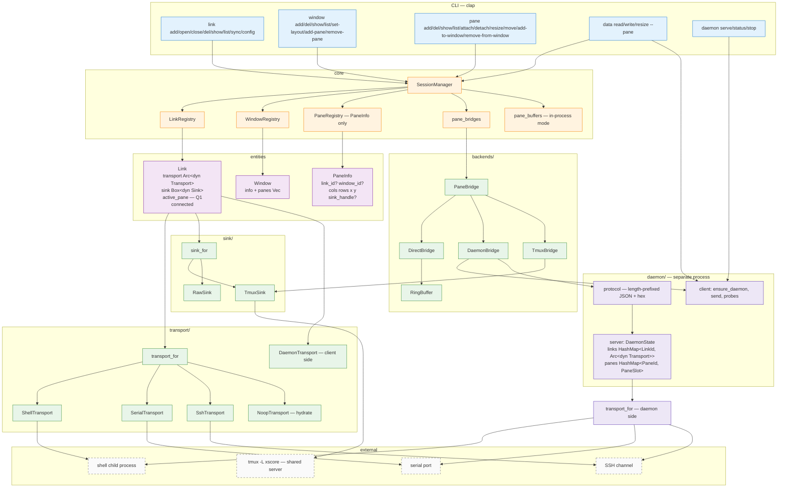
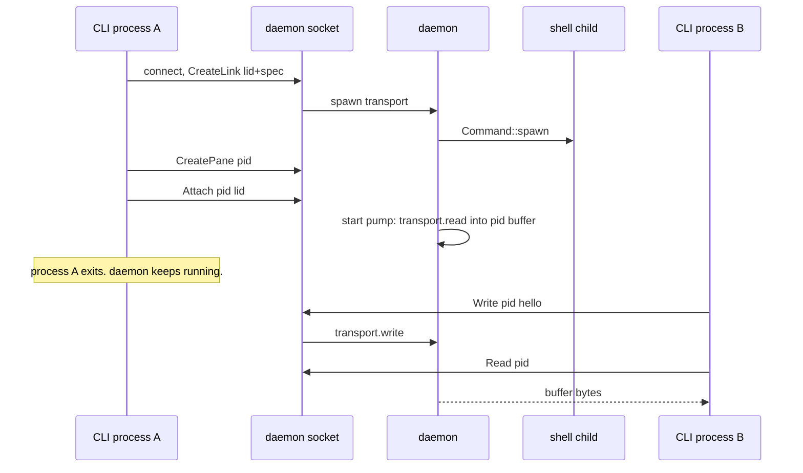
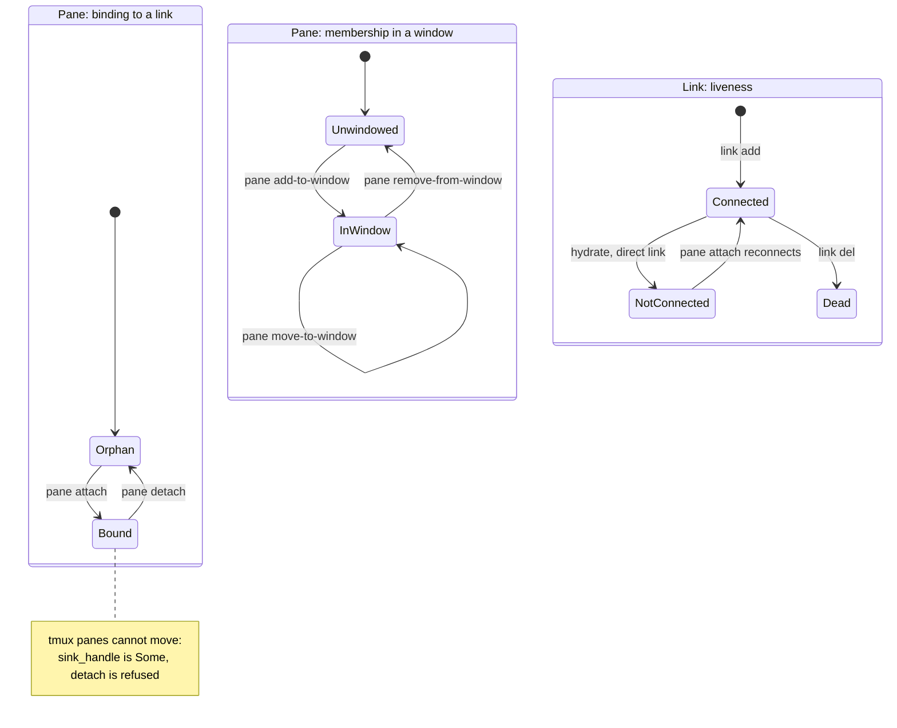
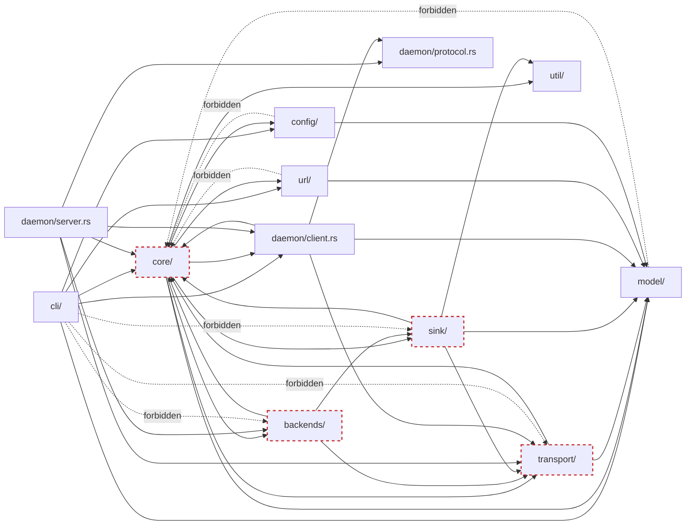

# Architecture

Runtime structure of `xscore` as of **v0.5.1**.

Read this if you want to know "what are the moving parts and which one owns
which fact". For the *why* behind each shape, follow the ADR links; this file
deliberately does not re-argue decisions.

Superseded diagrams live in `doc/dev/archive-*`. This file describes only the
current tree — do not trust it for versions before v0.3.0.

| ADR | Owns |
|---|---|
| [0001](../adr/0001-link-pane-model.md) | Link / Window / Pane as addressable tiers |
| [0002](../adr/0002-transport-sink-split.md) | Transport (bytes) vs Sink (terminal semantics) split |
| [0003](../adr/0003-external-tmux-server.md) | Shared external `tmux -L xscore`; never embed tmux |
| [0005](../adr/0005-add-open-close-del-verbs.md) | `add` / `del` / `open` / `close` verb split |
| [0006](../adr/0006-window-concept.md) | Window tier |
| [0007 v2](../adr/0007-raw-default-tmux-opt-in.md) | 3 entities decoupled; buffer-per-pane; Q1/Q2 |
| [0008](../adr/0008-tmux-adoption.md) | tmux is the source of truth; `@N` / `%N` identity anchors |
| [0009](../adr/0009-daemon.md) | Resident daemon owns direct-link transports and buffers |

## 1. Three entities, separately owned

The three nouns are **independent rows of state**. Associations are dynamic,
one-directional `Option` fields on the pane — nothing is nested.

```
Link      a connection.            Knows: its transport, its sink, its active pane.
Window    a layout container.      Knows: its own size, its layout hint, its pane list.
Pane      a buffer + geometry.     Knows: which link it is bound to, which window it sits in.
```

```rust
// core/link.rs
pub struct Link {
    pub id: LinkId,
    pub info: LinkInfo,                    // serializable: name, address, transport cfg, sink cfg
    pub transport: Arc<dyn Transport>,     // Arc so a bridge can share it
    pub sink: Box<dyn Sink>,               // tmux orchestration, or RawSink (no-op)
    pub tmux_sink: Option<Arc<TmuxSink>>,  // concrete sink, for building TmuxBridge
    pub active_pane: Mutex<Option<PaneId>>,// Q1: direct links allow one active pane
    pub connected: bool,                   // is the transport ALIVE right now?
}

// core/window.rs
pub struct Window {
    pub info: WindowInfo,                  // id, name, created_at, layout, cols, rows,
                                           //   tmux_window_handle: Option<"@N">
    pub panes: Mutex<Vec<PaneId>>,         // membership (see §8 for the duplication note)
}

// model/session.rs — there is no `Pane` struct.
pub struct PaneInfo {
    pub id: PaneId,
    pub name: String,
    pub created_at: DateTime<Utc>,
    pub cols: u16, pub rows: u16,          // Q2: the pane's size
    pub x: u16,    pub y: u16,             // Q2: its position inside the window
    pub link_id: Option<LinkId>,           // None = orphan (no live source)
    pub window_id: Option<WindowId>,       // None = not shown anywhere
    pub sink_handle: Option<String>,       // Some("%N") = tmux OWNS this pane
}
```

Two `Option` fields carry the whole association graph. That is the point of
ADR 0007 v2: a pane can be created with neither, then attached and placed
later, in either order.

`core/pane.rs` is a comment-only module. The pane's runtime half is not on
`PaneInfo` — see §3.

### Registries and the manager's maps

```
SessionManager
├── links   : LinkRegistry    by_id  + by_address (routing only, never a user key)
├── windows : WindowRegistry  by_id
├── panes   : PaneRegistry    by_id, holds PaneInfo ONLY (JSON-serializable)
├── pane_bridges : HashMap<PaneId, Arc<dyn PaneBridge>>       in-memory, rebuilt or dropped
├── pane_buffers : HashMap<PaneId, Arc<Mutex<RingBuffer>>>    in-process mode only
└── daemon  : Option<Arc<DaemonClient>>                        None = in-process mode
```

The split between `panes` and `pane_bridges` is deliberate: `PaneInfo` is
rewritten on every geometry change and every `save_state()`, and a bridge must
not be destroyed by that (it owns a running task / a socket handle).

## 2. Two I/O paths

There is no single "pane backend" any more. Which bridge a pane gets depends on
the **link's sink**, and only on that:

| Link sink (`SinkConfig`) | Bridge | Read comes from | Write goes to |
|---|---|---|---|
| `Raw` + daemon enabled | `DaemonBridge` | daemon's ring buffer for this pane | daemon → link transport |
| `Raw` + no daemon (tests) | `DirectBridge` | local ring buffer, filled by a pump over the link's transport | link transport |
| `Tmux { .. }` | `TmuxBridge` | `tmux capture-pane -p -t %N` | `tmux send-keys -t %N` |

`DaemonBridge` and `DirectBridge` share a contract but not a mechanism: the
daemon one is a socket round-trip, the direct one is an in-process pump
(`tokio::time::timeout(10ms, transport.read())` — the timeout matters, see
ADR 0008 §6 and the serial read-timeout note in v0.4.1).

`TmuxBridge` holds `Weak<TmuxSink>` + the `%N` handle. Weak is intentional: if
the link is dropped, the upgrade fails and the bridge reports
`Sink("tmux sink dropped")` instead of operating on a half-dead session.

### Why the pane's buffer is not on the pane

`PaneInfo` is persisted and rewritten; a 64 KiB scrollback is neither. So the
bytes live next to the bridge:

- tmux pane → no local buffer at all. tmux *is* the scrollback; every read is
  a `capture-pane`.
- direct pane, in-process → `pane_buffers[PaneId]`, kept when the bridge is
  dropped, so detach → read still returns history.
- direct pane, daemon → the daemon's `PaneSlot.buffer`. Same semantics, but it
  survives the CLI process.

## 3. Runtime topology



### What is deliberately absent

`BackendRegistry` / `PaneBackend` / `CompositeBackend` existed up to v0.2.0:
a `HashMap<PaneId, Arc<dyn PaneBackend>>` whose entries forwarded to
`link.sink`. They were deleted in v0.3.0 because the sink is no longer the only
I/O path — a direct pane never touches one. `pane_bridges` + `PaneBridge` is the
same lookup table without the extra hop.

## 4. The daemon

A direct link's transport is created by the process that asked for it. Before
v0.5.0 that was the CLI process, so `link add` followed by `data write` in a
later invocation was impossible by construction. The daemon fixes that by
owning the two things that must outlive a single command:

```
links: HashMap<LinkId, Arc<dyn Transport>>     live direct transports
panes: HashMap<PaneId, PaneSlot>               PaneSlot { link, buffer, pump }
```

The CLI keeps owning `state.json`; the daemon owns bytes. tmux links never go
through it — tmux already is a resident server.



Wire format: `[u32 LE length][JSON]`, one request per connection, binary as hex.
Ops: `ping`, `status`, `create_link`, `delete_link`, `create_pane`,
`delete_pane`, `attach`, `detach`, `read`, `write`, `resize`, `stop`.

Process rules (each is a bug that was hit, not a preference):

| Rule | Why |
|---|---|
| Spawned via `setsid` | otherwise closing the terminal SIGHUPs the daemon and drops every link |
| SIGHUP swallowed; SIGTERM/SIGINT left alone | survive terminal close, but keep `daemon stop` and foreground Ctrl-C working |
| Startup `daemon.lock` taken with `create_new` before binding | two concurrent auto-starts each unlink-and-bind, leaving a daemon on an orphaned inode |
| Stale socket unlinked before bind | crashed daemon leaves a socket nobody answers |
| Idle exit when `links` is empty for 5s | tests must not leak daemons. Buffers die with the daemon |
| `delete_link` unbinds panes but keeps their slots | a direct pane's history outlives its link (ADR 0008 §5) |

## 5. Lifecycle

Three independent lifecycles. The only cross-entity rule is Q1.



Invariants, and what enforces each:

- **Q1 — a direct link has at most one bound pane.** `attach_pane` scans
  `PaneInfo` for other panes with this `link_id` and detaches them first. The
  daemon repeats the scan on its own side, because a CLI can be killed between
  the two steps.
- **tmux panes are not movable.** `sink_handle.is_some()` ⇒ `detach_pane` and
  `link add --pane` return `TmuxLinkCannotBindPane` / `TmuxPaneNotDetachable`.
- **`window_id` and `link_id` are independent.** A pane can be in a window with
  no link (shows history, cannot write) or bound with no window (live I/O, not
  displayed). Both combinations are reachable and legal.
- **Binding ≠ liveness.** `pane.show` reports `link_id`; `link.show` reports
  `connected`. After a restart a direct link has the first and not the second;
  data ops then say `LinkNotConnected`, never `NotAttached`.
- **`link close` is tmux-only** (detach: registry rows dropped, session stays).
  `link del` is universal teardown. Direct links have no `close` semantics —
  there is nothing to detach to.
- **`del_link` on a direct link** closes the transport once and orphans its
  panes (history kept). On a tmux link it kills the session, and the panes die
  with it — tmux owns them.

## 6. Module dependency rules

Solid = allowed. The dashed block at the bottom is what must never appear.



Two honest notes:

- `core → daemon/client` and `daemon/client → core` is an **intra-crate cycle**.
  It exists because `core` needs `DaemonClient` as a field type and
  `DaemonClient` needs `Error` / `LinkId` / `Result`. It is tolerated while the
  back-edge only touches those leaf types. If the client starts needing manager
  state, move a `LinkStore` trait into `core` and implement it on the client.
- `daemon/server` is only reachable from `main.rs` (the `daemon serve`
  subcommand), never from `core`. That is what keeps "CLI may run in-process"
  and "daemon may run as a server" from collapsing into one path.

## 7. End-to-end: `xscore data write --pane <pid>`

`manager.data_write(pid, data)` → `bridge_for(pid)` → one of the three bridges.
`bridge_for` is the only place that decides, so the two failure modes cannot
drift apart:

```
bridge_for(pid)
├── pane_bridges has pid             → use it
├── PaneInfo.link_id is Some(lid) and link.connected == false
│                                     → Error::LinkNotConnected(lid)
└── otherwise                         → Error::NotAttached(pid)
```

Direct, daemon mode:

```
CLI: data write --pane P
  → manager.data_write(P, bytes)
  → DaemonBridge::write
  → socket: {"op":"write","pane":"P","data":"<hex>"}
  → daemon: PaneSlot[P].link → links[lid].write(bytes)
  → shell child stdin
```

Direct, read:

```
CLI: data read --pane P
  → DaemonBridge::read
  → socket: {"op":"read","pane":"P","max":4096}
  → daemon: copy out PaneSlot[P].buffer      (filled by the pump, not consumed)
```

tmux:

```
CLI: data write --pane P
  → TmuxBridge::write
  → tmux -L xscore send-keys -l -t %N ...
CLI: data read --pane P
  → TmuxBridge::read
  → tmux -L xscore capture-pane -p -t %N
```

Reads are **non-destructive snapshots** in all three paths: the buffer is
scrollback, not a stream. `Ok(0)` means "nothing buffered yet".

## 8. Known duplications and gaps

State that is stored twice, or modelled but not used. Listed so the next reader
does not mistake them for invariants.

| Item | Status |
|---|---|
| `Window.panes: Vec<PaneId>` **and** `PaneInfo.window_id` | Both written on every membership change, no transaction. `window_id` is authoritative for reads; `Window.panes` is the ordered list (which the layout hint will need). A crash between the two writes can desync them. |
| `Link.active_pane` **and** `PaneInfo.link_id` | `attach_pane` rewrites both. Q1 recovery scans `PaneInfo`, so a desync self-heals on the next attach. |
| `WindowLayout` (`single`/`tabs`/`split_h`/`split_v`/`grid`) | Stored, validated, never consumed. There is no renderer. It is a hint for a future UI. `tabs` has no tmux equivalent. |
| `PaneInfo.x` / `y` | Stored, never validated against the window bounds, never used for placement. |
| `xscore config` | Stub. `AppConfig` does not exist yet. |
| `link open` (local tmux) | `todo!()`. Non-tmux links correctly return `OpenOnlyForTmux`. |
| Concurrent `state.json` writers | Last writer wins. Two simultaneous mutating commands can drop one update. |
| Daemon idle exit | Drops in-memory pane buffers (they are not persisted). |

## 9. State file

`~/.config/xscore/state/state.json`, `schema_version: 2`, atomic write to a
per-process temp name then rename. Older versions are rejected with a message
telling the user to delete the file — a silent empty parse would look like data
loss.

```json
{
  "schema_version": 2,
  "links":   [{ "id": "...", "info": { "name": "...", "address": {...},
                                       "transport": {...}, "sink": {...} } }],
  "windows": [{ "id": "...", "info": { "name": "...", "layout": {"kind":"single"},
                                       "cols": 120, "rows": 30,
                                       "tmux_window_handle": "@0" },
                "panes": ["<pid>", "..."] }],
  "panes":   [{ "id": "...", "info": { "name": "...", "cols": 80, "rows": 24,
                                       "x": 0, "y": 0,
                                       "link_id": "...", "window_id": "...",
                                       "sink_handle": "%0" } }]
}
```

Three flat lists. Nothing is nested, because no entity owns another. Bridges,
pumps and daemon sockets are runtime-only and never serialized; tmux bridges are
rebuilt from `sink_handle` on hydration.
