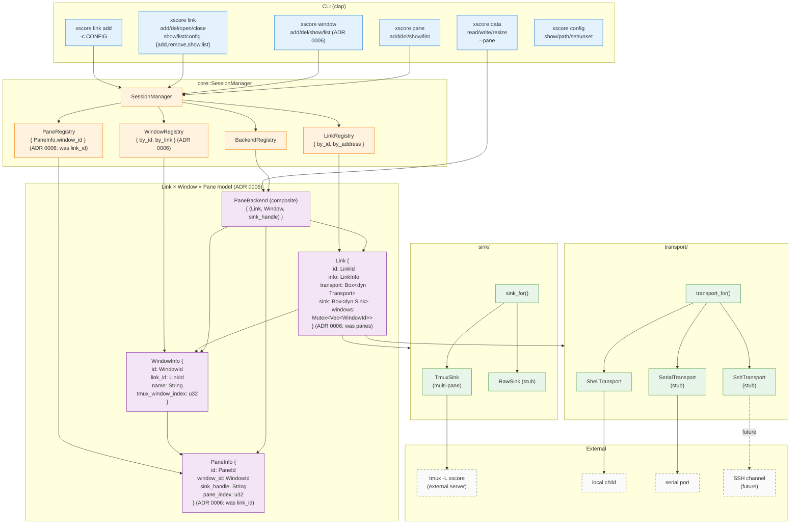
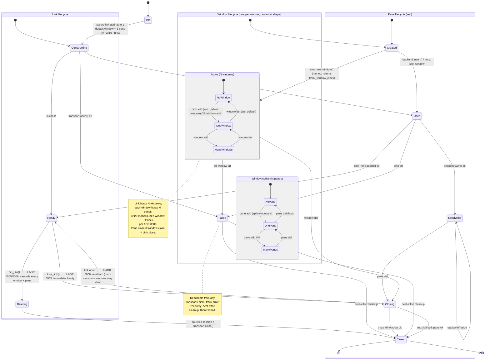
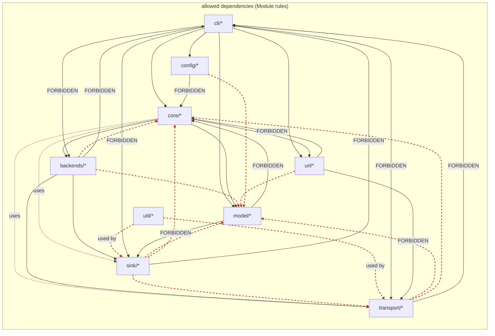

# Architecture Diagrams

## 1. Link × Window × Pane topology

Runtime structure: CLI surface, `SessionManager`, three registries, the
`Link` / `Pane` structs, `Transport` × `Sink` trait impls, and external
processes (tmux session inside shared `-L xscore`, local child, serial port, future SSH channel).
Color-coded by layer.

Read first if you want to know "what are the moving parts".

## 2. Link × Window × Pane state machines

Three parallel state diagrams (ADR 0006).

- **Link lifecycle**: `Idle → Constructing → Open → Ready → Closing → Closed` for the **resource**
  (tmux session stays alive across `Closing` — i.e. `close` is tmux-detach). For full teardown the path
  is `Ready → Deleting → Closed` (deletes the per-link tmux session; cascades every window + pane).
  A sub-machine `Active (N windows)` for the steady state (`NoWindow ↔ OneWindow ↔ ManyWindows`).
- **Window lifecycle**: `Created → Active → Closing → Closed` for the **tmux window** inside the link's
  session. With its own `Active (M panes)` sub-machine.
- **Pane lifecycle**: `Created → Open → ReadWrite ↔ Closing → Closed`. The leaf — no further sub-machine.

Key invariants (ADR 0005 verb split + ADR 0006 3-tier model):

- `close_link()` (which is `xscore link close`) is **tmux-detach only** — unregisters the link + every window + every pane in-memory; the tmux session + windows stay alive on the tmux server. Re-attach with `link open` (same session comes back, panes re-discovered).
- `del_link()` (which is `xscore link del`) is **full teardown** — kills the per-link tmux session (cascades every window + pane). The shared `tmux -L xscore` server stays up.
- `window del()` kills one tmux window; panes inside die with it (`tmux kill-window`).
- `pane del()` kills one tmux split-window; the parent window and link are unaffected.
- `link add` auto-creates one default window (named `w-<first 8 hex chars of link_id>`, e.g. `w-01928e0a`) and one default pane inside it — common path stays one step.
- Pane close ≠ Window close ≠ Link close (each level is independent).
- Failed is reachable from any transport / sink / tmux error; cleanup is best-effort.

## 3. Module dependency rules

Directed graph of allowed dependencies between top-level modules
(`cli`, `core`, `model`, `url`, `transport`, `sink`, `backends`, `config`,
`util`). Solid arrows = allowed. Dashed red X arrows = forbidden
(e.g. `cli` cannot import `transport` directly).

This is the "hard rules" section of [`overview.md`](../../roadmap/overview.md)
rendered as a graph.

