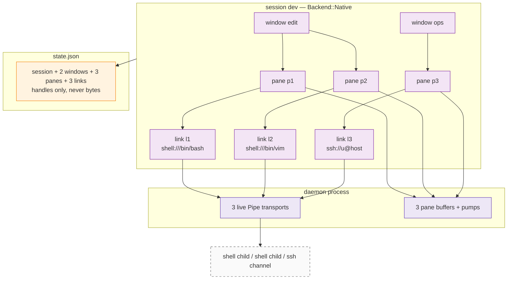
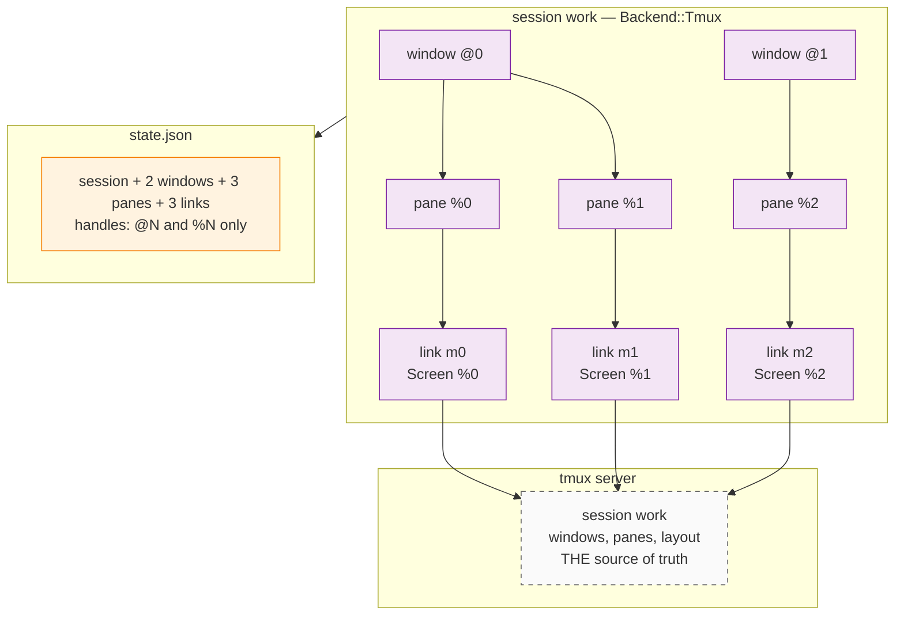
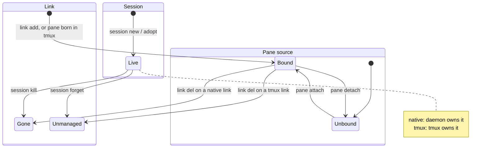
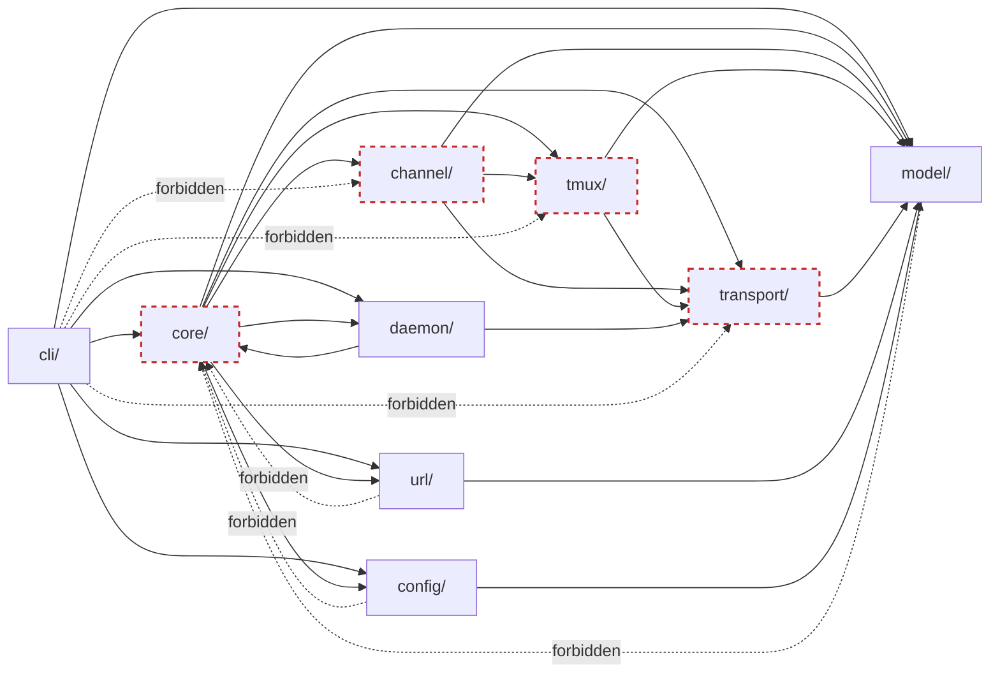

# Architecture — target design

**Status: design only.** This describes the architecture for **v0.6.0**. The
code at `HEAD` is v0.5.1 and does not match it yet — see
[§10 Delta](#10-delta-from-v051) for the gap and the migration.

For the as-built description of v0.5.1:

```bash
git show v0.5.1:doc/dev/arch/arch.md
```

This file is the shape, not the argument. Rationale lives in the ADRs:

| ADR | Owns |
|---|---|
| [0001](../adr/0001-link-pane-model.md) | Link / Window / Pane as addressable tiers |
| [0002](../adr/0002-transport-sink-split.md) | Transport vs Sink split — *Sink is retired by this design* |
| [0003](../adr/0003-external-tmux-server.md) | External tmux, never embedded |
| [0005](../adr/0005-add-open-close-del-verbs.md) | Verb semantics — *`open`/`close` move to `session`* |
| [0006](../adr/0006-window-concept.md) | Window tier |
| [0007 v2](../adr/0007-raw-default-tmux-opt-in.md) | Decoupled entities, buffer-per-pane, Q1/Q2 |
| [0008](../adr/0008-tmux-adoption.md) | tmux is the source of truth; `@N` / `%N` anchors |
| [0009](../adr/0009-daemon.md) | Resident daemon owns native transports and buffers |

## 0. The model in one screen

A **session is a workspace with a backend**. The backend decides who keeps the
processes alive and who owns the structure:

```
Session ── workspace; 1:1 with a tmux session, or standalone
  ├ Window ── layout container
  ├ Pane   ── buffer + geometry
  └ Link   ── one connection (an endpoint)
```

| | `Backend::Native` | `Backend::Tmux { .. }` |
|---|---|---|
| keeps processes alive | the resident daemon | the tmux server |
| Window | xscore grouping; no layout engine | mirrors a tmux window (`@N`) |
| Pane | xscore buffer + geometry | is a tmux pane (`%N`) |
| Link endpoint | `Pipe` — a byte stream | `Screen` — capture / send-keys |
| survives CLI exit | yes (daemon) | yes (tmux) |
| attach a human | n/a | `exec tmux attach` |
| multi-client | no | yes |

That table is why `Session` exists. "Does this go through tmux?" was never a
property of a *link*; it is a property of the *workspace* the link lives in.

### A session is a container, not a viewport

Both backends hold **N windows, each with N panes, each pane bound to at most
one link**. Cardinality is not what separates them — ownership is.

```
session dev                                  (Backend::Native)
├── window "edit"
│   ├── pane p1 ── link l1   shell:///bin/bash
│   └── pane p2 ── link l2   shell:///bin/vim
└── window "ops"
    ├── pane p3 ── link l3   ssh://u@host
    └── pane p4 ── link l4   serial:///dev/ttyUSB0

session work                                 (Backend::Tmux { session: "work" })
├── window @0
│   ├── pane %0 ── link l5
│   └── pane %1 ── link l6
└── window @1
    └── pane %2 ── link l7
```

```
Session 1:N Window      Window  1:N Pane       Pane 0..1 Link   (unbound = history only)
Session 1:N Link        Session 1:N Pane       Link 0..1 Pane   (serves at most one)
```

A native session is a *workspace*, not a single shell: it can hold several
windows, several panes, and links of **mixed kinds** at the same time (shell +
ssh + serial in one workspace is a normal case). A tmux-backed session gets the
same multiplicity from tmux, which additionally owns the layout.

`session new` creates initial content so the common path stays one step — one
window plus one link and one pane, mirroring what tmux does — but that is a
convenience, not a limit. Grow it with `window new`, `link add`, `pane new`.

## 1. Session

```rust
pub struct SessionInfo {
    pub id: SessionId,
    pub name: String,
    pub created_at: DateTime<Utc>,
    pub backend: SessionBackend,
}

pub enum SessionBackend {
    /// Links are byte pipes owned by the daemon; windows are xscore's own
    /// grouping. Dies when the daemon forgets it.
    Native,

    /// This session IS a tmux session. Windows and panes are read from tmux;
    /// xscore stores only the handles it adopted.
    Tmux {
        /// None = tmux's default socket, Some("xscore") = `tmux -L xscore`.
        socket: Option<String>,
        /// tmux session name. Deliberately NOT derived from SessionId:
        /// tmux sessions are user-visible and user-nameable.
        session: String,
    },
}
```

`Backend::Tmux` is the 1:1 correspondence held as a **pointer, not a mirror**.
xscore does not keep a second copy of tmux's structure that could drift; when a
command touches a tmux-backed session it **refreshes that one session** from
tmux (see §6) and acts on what tmux reports.

## 2. Window

```rust
pub struct WindowInfo {
    pub id: WindowId,
    pub session_id: SessionId,
    pub name: String,
    pub created_at: DateTime<Utc>,
    pub backend: WindowBackend,
}

pub enum WindowBackend {
    /// xscore-side grouping. Panes inside are a list; there is no renderer,
    /// so there is no layout to describe.
    Native,
    /// Mirrors a tmux window. Layout is read from tmux on demand
    /// (`#{window_layout}`) and never stored.
    Tmux { handle: String },   // "@N"
}
```

**`WindowLayout` is deleted.** It was a five-variant enum (`single`, `tabs`,
`split_h`, `split_v`, `grid`) with zero consumers: tmux owns layout for tmux
windows, and nothing renders native ones. A stored layout hint nobody applies
reads like a feature. When a UI layer exists it can introduce a layout model
shaped by what that layer actually needs.

## 3. Pane

A pane is a **buffer with a viewport** — the unit users read and write.

```rust
pub struct PaneInfo {
    pub id: PaneId,
    pub session_id: SessionId,
    pub name: String,
    pub created_at: DateTime<Utc>,
    pub cols: u16, pub rows: u16,      // size
    pub x: u16,    pub y: u16,         // position inside its window
    pub window_id: Option<WindowId>,   // None = not displayed
    pub link_id: Option<LinkId>,       // None = no source; history only
    pub backend: PaneBackend,
}

pub enum PaneBackend {
    Native,
    /// This pane IS tmux pane `%N`. Its identity is the handle: it cannot be
    /// re-bound to another link, and it dies with its tmux session.
    Tmux { handle: String },
}
```

The pane's **bytes are not in `PaneInfo`** — it is rewritten on every geometry
change and every save, and a 64 KiB scrollback is neither. The bytes live beside
the channel:

- native pane → `RingBuffer` (64 KiB) in the daemon (or in-process in tests).
  Survives `detach`; read is a non-destructive snapshot.
- tmux pane → no local buffer. tmux *is* the scrollback; each read is a
  `capture-pane`.

## 4. Link and Endpoint

A link is **one connection**: a handle you can list and hand to at most one pane.

```rust
pub struct LinkInfo {
    pub id: LinkId,
    pub session_id: SessionId,
    pub name: String,
    pub created_at: DateTime<Utc>,
    /// What this link is attached to. The tmux session is NOT repeated here:
    /// it is implied by `session_id` (`SessionInfo::backend`). Only the pane
    /// handle is local to the link, so a session rename can never leave a
    /// stale name behind in a link.
    pub endpoint: EndpointRef,
}

pub enum EndpointRef {
    /// shell / serial / ssh — a byte stream, owned by the daemon.
    Pipe(TransportConfig),
    /// A tmux pane in this session's tmux session.
    Screen { pane: String },   // "%N"
}

// Runtime, never serialized:
pub enum Endpoint {
    Pipe(Arc<dyn Transport>),
    Screen { tmux: Arc<TmuxSession>, pane: String },
}
```

`Endpoint` is the honest split. A tmux pane cannot pretend to be a byte stream:
reads are non-destructive screen snapshots, writes are key injection, and
binary output is not recoverable. Stating that once here is better than
discovering it per call site.

### Every link is exclusive

Q1 ("a direct link serves one pane at a time") stops being a special case and
becomes the only rule: **a link is handed to at most one pane**. Multi-pane is a
*backend* capability — `Backend::Tmux` gives you N panes by giving you N links,
one per tmux pane.

That is also why `Sink` is retired (§9): `capacity` / `grant` / `revoke` only
existed to express "this link may be shared", and after this change nothing may.

### What a link is not

- not a tmux session (a session is a session)
- not a pane (a pane consumes a link)
- not an owner of windows or panes

## 5. Runtime topology

Both pictures below are *structure*, not call sequences — the point is that a
session holds many windows, many panes and many links.

### Native session



### tmux-backed session



The difference between the two pictures is the whole design: **native keeps
bytes, tmux keeps structure.** xscore keeps handles in both cases, and bytes
only in the native case.

## 6. Refresh, not sync

A tmux-backed session has rows in `state.json` (windows, panes, links) but tmux
owns their truth. The rule, applied **per session** and only when a session is
touched:

```
touch(session) →
  tmux list-windows + list-panes -t <tmux session>
  for each adopted row whose handle is gone   → remove the row; its pane's
                                                 link_id becomes None
  for each adopted row whose geometry changed → update cols/rows/x/y
  panes that tmux reports but xscore never adopted → REPORTED, not adopted
```

Notes that make this different from v0.5.1's `link sync --heal`:

- **Scoped to one session.** A refresh can never touch another session's rows
  (v0.4.0 shipped that bug once and fixed it).
- **No adoption by default.** Panes the user created by hand in tmux stay
  invisible to xscore until `xscore session adopt <name>`.
- **No `--heal` flag.** Healing is the only behaviour; there is no mode where a
  known-stale row is kept.
- **No global pass.** Nothing walks all sessions; a session is refreshed because
  a command mentioned it.
- **Refresh is in-memory.** Removed rows and changed geometry are applied to the
  in-memory registries only; persistence rides on the normal save at the end of
  a *mutating* command. A read-only command (`ls`, `show`, `data read`) must not
  write `state.json` — otherwise every read would contend for the file and every
  user would see a mutation they did not ask for.

`session adopt <name>` is the explicit "take the current tmux structure as
xscore rows" operation — the way to start managing a session you created outside
xscore.

## 7. Lifecycle and invariants



Invariants and what enforces each:

- **A link serves at most one pane.** Per-session scan on attach; no other
  capacity exists.
- **A pane's link is in the same session.** Cross-session moves only via an
  explicit `pane move --session`, never as a side effect of `attach`.
- **A tmux pane cannot be detached.** `PaneBackend::Tmux` is its identity;
  `pane detach` refuses. Destroying it is `pane kill`.
- **A tmux handle is never an index.** `@N` / `%N` only — indices shift on
  rename and reorder.
- **Binding ≠ liveness.** `pane show` reports `link_id`; `link show` reports
  `connected`. A native link after a restart keeps the binding and loses the
  connection → `LinkNotConnected`, never `NotAttached`.
- **Killing a session is the only cascade.** It removes its windows, panes and
  links and nothing else.
- **`link del` on a tmux link forgets the handle.** The tmux pane and its
  session survive: a handle is not an owner. To destroy tmux state use
  `pane kill` / `session kill`.
- **`session forget` leaves the backend running.** Drops xscore's rows only
  (tmux-backed sessions; for native it is equivalent to `kill`, because the
  daemon is the backend).

## 8. Module structure (target)

```
crates/xscore/src/
  core/        ids, error, address, session, link, pane, window, registries,
               manager, state, buffer (RingBuffer), refresh
  model/       SessionInfo, LinkInfo, WindowInfo, PaneInfo,
               SessionBackend, WindowBackend, PaneBackend, TransportConfig
  channel/     Channel trait, PipeChannel, ScreenChannel, DaemonChannel
  transport/   Transport trait, shell, serial, ssh, NoopTransport, DaemonTransport
  tmux/        TmuxHost (Local / ThroughTransport), structure queries, session runtime
  daemon/      protocol, server, client
  url/         URL parser
  config/      link templates
  cli/         session, window, pane, link, data, daemon
```

`backends/` disappears: it held the conduit (`PaneBridge`) and the pane's buffer.
The conduit becomes `channel/`; the buffer moves to `core/buffer.rs` because it
belongs to the pane, not to the connection.



Two notes that survive from v0.5.1:

- `core ↔ daemon` is the one tolerated cycle: `core` holds a `DaemonClient`
  field and the client needs `Error` / ids. Tolerable while the back-edge only
  touches those leaf types; if it grows, extract a `LinkStore` trait into
  `core`.
- `daemon/server` is reachable only from `main.rs` (`daemon serve`), never from
  `core`. That keeps "run in-process" and "run as a server" from collapsing into
  one path.

## 9. Command surface

```bash
# Session — the workspace
xscore session ls [--all]
xscore session new <name> [--tmux [--socket S]] [--empty] [--cmd C] [--cwd D]
                          [--cols N --rows N]
xscore session adopt <name> [--socket S]     # take over an existing tmux session
xscore session show <name>                   # its windows / panes / links
xscore session attach <name>                 # tmux: exec tmux attach; native: unsupported
xscore session kill <name>                   # destroy the backend and the rows
xscore session forget <name>                 # drop xscore rows, leave backend running
xscore session rename <old> <new>

# Window — scoped to a session
xscore window ls   --session <s>
xscore window new  --session <s> [--name N] [--cmd C] [--cwd D]
xscore window kill <w>
xscore window rename <w> <new>

# Pane — scoped to a session
xscore pane ls   [--session <s>] [--window <w>]
xscore pane new  --session <s> [--window <w>] [--cmd C] [--cwd D] [--cols N --rows N]
xscore pane kill <p>
xscore pane attach --pane <p> --link <l>     # native only
xscore pane detach --pane <p>                # native only
xscore pane move   --pane <p> --window <w>   # within the session

# Link — native sessions
xscore link add <url> --session <s>
xscore link ls  [--session <s>]
xscore link del <l>

# Data — any pane
xscore data read  --pane <p> [--bytes N]
xscore data write --pane <p> [< file | --from-file F]
xscore data resize --pane <p> --cols C --rows R
```

Notes:

- `--cmd` / `--cwd` belong to the verbs that **start a process** (`session new`,
  `window new`, `pane new`). URLs only say how to connect. This is where the
  command that v0.5.1 silently dropped (`?tmux=on` ignored the URL's command)
  now lives.
- `session new` starts the workspace with **one window, one link, one pane**
  so the common path stays a single command. `--empty` skips that for a native
  session (bare workspace); it is a no-op for `--tmux`, where tmux always
  creates at least one pane.
- `session new` creates a *workspace*, not one viewport. A native session can
  hold several windows and links of mixed kinds (shell + ssh + serial) at the
  same time — see §0.
- For a tmux session, `pane new` is atomic: `split-window`, adopt `%N`, create
  the link, bind them. A tmux pane is born bound.
- `session attach` replaces `link open`; `session kill` / `session forget`
  replace `link close`. `link` loses both verbs.
- `?tmux=on|auto|local|remote` is **removed**. Whether a session is tmux-backed
  is decided at `session new` / `session adopt`.
- `tmux://` is **not** a link URL. Adoption happens at the session level.

## 10. Delta from v0.5.1

### Removed

| Gone | Why |
|---|---|
| `Sink` trait, `RawSink`, `TmuxSink: Sink` | no link may be shared, so `capacity` / `grant` / `revoke` have nothing to express |
| `Link.sink: Box<dyn Sink>` | it was dead: one `no-op attach` call, then never touched |
| `Link.active_pane` (Q1 ledger) | exclusivity follows from "one link, one pane" |
| `SinkConfig::{Raw, Tmux}` | replaced by `SessionBackend`; a link no longer knows about tmux |
| `?tmux=on|auto|local|remote` | tmux-ness is a session property |
| `WindowInfo.tmux_window_handle`, `PaneInfo.sink_handle` | folded into `WindowBackend::Tmux` / `PaneBackend::Tmux` |
| `WindowLayout` (5 variants) | no consumer; tmux owns layout, native has no renderer |
| `link open` / `link close` | `session attach` / `session kill` / `session forget` |
| `link sync [--heal]` | replaced by per-session refresh (§6): same data, no mode flag, no global pass |
| `backends/` module | split into `channel/` (the conduit) and `core/buffer.rs` |

### Added

| New | Role |
|---|---|
| `Session` + `SessionId` + `SessionBackend` | the workspace, and who keeps it alive |
| `Endpoint::{Pipe, Screen}` | the honest split between byte streams and tmux screens |
| `channel/{Pipe,Screen,Daemon}Channel` | what a pane reads and writes through |
| `tmux::TmuxHost` (`Local`, `ThroughTransport`) | where tmux commands run — the seam for remote tmux |
| `session adopt` / `session forget` | manage sessions xscore did not create; stop managing without destroying |
| `pane new --window` on a tmux session | creates tmux pane + link + pane atomically |

### Changed

| Area | v0.5.1 | v0.6.0 |
|---|---|---|
| state schema | v2: flat `links`/`windows`/`panes` | **v3**: adds `sessions`; every child carries `session_id`; backends replace `sink` / `sink_handle` / `tmux_window_handle` |
| `link add` | no session | requires `--session` (a native session) |
| Q1 | special case in `attach_pane` | universal: one link → one pane |
| tmux control | `Sink` methods + `link sync` | `session` / `window` / `pane` verbs; tmux queried per session |
| remote tmux | `?tmux=remote` (silently local) | `TmuxHost::ThroughTransport` seam; not implemented, not advertised |
| `Window.layout` | stored enum | gone; `#{window_layout}` read from tmux when needed |

### Migration (v2 → v3)

`schema_version: 3`; v2 files are rejected with an actionable error, not
silently converted (same policy as v0.4.0). The one-time migration:

1. each existing tmux link → `Session { backend: Tmux { socket, session } }`
   named after the link; its `@N` / `%N` handles move into the child backends.
2. each existing native (raw) link → `Session { backend: Native }` named after
   the link; its pane keeps the binding.
3. windows and panes are re-parented to the session they came from.
4. `link sync` output is discarded — it described cached structure that is now
   refreshed per query.

## 11. Open decisions

| # | Question | Lean |
|---|---|---|
| D1 | Does a tmux-backed session have explicit `Link`s (1:1 with panes), or do panes hold a `Screen` endpoint directly? | **Explicit links.** One binding rule ("a pane uses a link") beats two, and it is where exclusivity lives. Cost: a 1:1 link that can never be re-bound. |
| D2 | Window mirroring for tmux sessions: mirror `@N`, or keep one tmux window and treat xscore windows as private? | **Mirror `@N`.** `tmux attach` must show what xscore shows, or the product premise breaks. |
| D3 | `WindowLayout`: delete for good, or keep a hint for native windows? | **Delete.** No consumer; reintroduce with the renderer. |
| D4 | tmux socket: private `-L xscore`, or the user's default socket? | **Default socket**, `--socket` to override. Sessions invisible in `tmux ls` are not "managed". Tests pass `--socket` explicitly. |
| D5 | `link del` on a tmux-backed link | **Forget the handle only.** A link is a view, not an owner. |
| D6 | Can a pane move between sessions? | **No implicit moves.** `pane move --session` is explicit and native-only. |
| D7 | `session forget` — needed, or is `kill` enough? | **Keep it.** Mirrors v0.5.1's `del` vs `close`: destroy vs stop managing. |
| D8 | Alternative to mirroring: address tmux directly (`data --tmux work:1`) and have no xscore rows for tmux at all | **Rejected for now**, because it gives two addressing modes for `data`. Revisit if per-session refresh proves troublesome. |

## 12. What this does not solve

- **tmux has no byte stream.** `Screen` endpoints cannot carry binary, exact byte
  order, or exit codes. Anything needing that must be a native session.
- **No renderer.** Native windows have no layout model and no drawing code;
  `pane.cols/rows/x/y` are recorded but unenforced. The tmux backend is the only
  one that can display anything to a human today.
- **No remote tmux.** `TmuxHost::ThroughTransport` is a seam, not an
  implementation.
- **Concurrent `state.json` writers still last-writer-wins.** Unchanged from
  v0.5.1. Sessions shrink the blast radius (mutations are scoped) but add no
  locking.
- **Daemon idle exit still drops native pane buffers** (they are not persisted).
