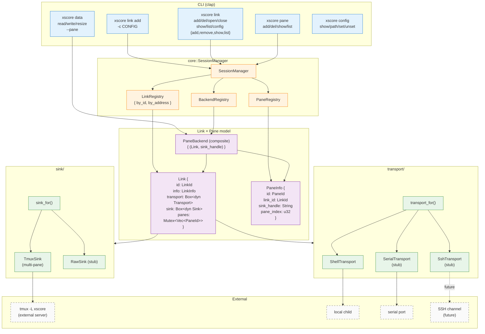
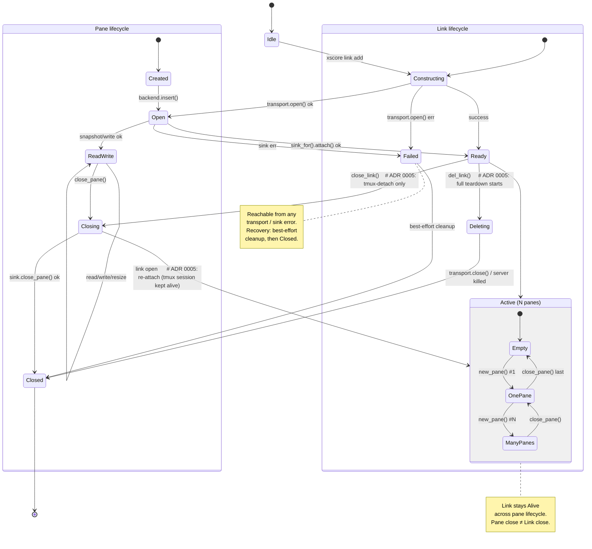
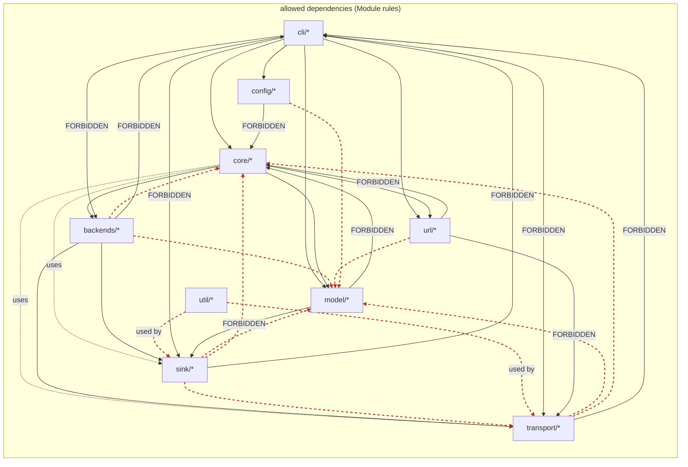

# Architecture Diagrams

Inline Mermaid diagrams for the xscore architecture. Each block below renders
in any Markdown preview that supports Mermaid (GitHub, GitLab, IDE preview,
Obsidian, etc.), or paste into https://mermaid.live for an instant check.

If you need a standalone SVG (e.g. for a slide deck), paste a diagram into
https://mermaid.live and use its export panel, or run any Mermaid CLI
(e.g. `npm i -g @mermaid-js/mermaid-cli`) against the diagram body. The
`mermaid` fenced blocks here are the source of truth — there are no
separate source files to keep in sync.

## 1. Link × Pane topology

Runtime structure: CLI surface, `SessionManager`, three registries, the
`Link` / `Pane` structs, `Transport` × `Sink` trait impls, and external
processes (tmux server, local child, serial port, future SSH channel).
Color-coded by layer.

Read first if you want to know "what are the moving parts".

## 2. Link & Pane state machines

Two parallel state diagrams.

- **Link lifecycle**: `Idle → Constructing → Open → Ready → Closing → Closed` for the **resource**
  (tmux session stays alive across `Closing` — i.e. `close` is tmux-detach). For full teardown the path
  is `Ready → Deleting → Closed` (deletes the tmux server). Both paths emerge from `Ready`.
  A sub-machine `Active (N panes)` for the steady state (`Empty ↔ OnePane ↔ ManyPanes`).
- **Pane lifecycle**: `Created → Open → ReadWrite ↔ Closing → Closed`.

Key invariants (ADR 0005 verb split):

- `close_link()` (which is `xscore link close`) is **tmux-detach only** — the link is unregistered
  in-memory, panes go away, the tmux session keeps running. Re-attach with `link open`.
- `del_link()` (which is `xscore link del`) is the **full teardown** — it kills the per-link
  tmux server and every pane, and only then reaches `Closed`.
- Link stays Alive across pane lifecycle (Pane close ≠ Link close).
- Failed state is reachable from any transport / sink error; cleanup is best-effort.

## 3. Module dependency rules

Directed graph of allowed dependencies between top-level modules
(`cli`, `core`, `model`, `url`, `transport`, `sink`, `backends`, `config`,
`util`). Solid arrows = allowed. Dashed red X arrows = forbidden
(e.g. `cli` cannot import `transport` directly).

This is the "hard rules" section of [`overview.md`](../../roadmap/overview.md)
rendered as a graph.

## Cross-references

- [`overview.md`](../../roadmap/overview.md) — text version of the architecture
- [ADR 0001](../../adr/0001-link-pane-model.md) — Link × Pane model rationale
- [ADR 0002](../../adr/0002-transport-sink-split.md) — Transport × Sink split rationale
- [ADR 0003](../../adr/0003-external-tmux-server.md) — External tmux server rationale
- [ADR 0005](../../adr/0005-add-open-close-del-verbs.md) — four-verb `link` tree (replaces the archived ADR 0004)

## Updating

When the architecture changes:

1. Edit the `mermaid` block directly in this file.
2. If the change is structural (new trait, new registry, new module), update
   both `overview.md` and the relevant ADR **before** touching the diagram.
3. Don't let a diagram drift from `overview.md`. The text and the diagram
   are a pair — they describe the same architecture, and drift between them
   is a bug, not a stylistic difference.
