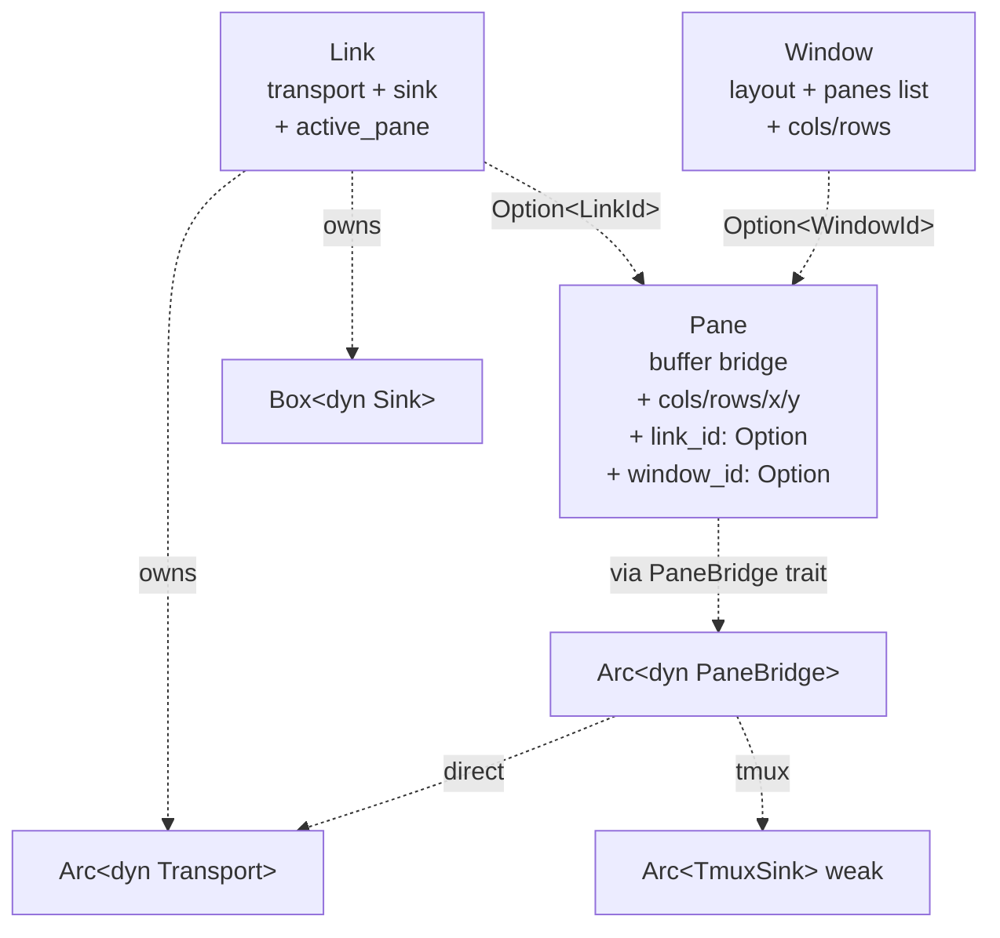

# Roadmap overview

**Goal:** Build the CLI-first slice of xscore — a Rust workspace that manages SSH / shell / serial sessions as three independent entities (Link, Pane, Window) wired together by Option<> associations on Pane (ADR 0007 v2, v0.3.0), callable from `xscore` CLI today and (later) from MCP server and IPC server without code rewrite.

**Architecture Decision Records (read first, in order):**
- [ADR 0001](../adr/0001-link-pane-model.md) — why Link × Window × Pane; superseded by ADR 0007 v2 (independent entities)
- [ADR 0002](../adr/0002-transport-sink-split.md) — why Transport × Sink (not single backend); Sink is optional (`RawSink` | `TmuxSink`)
- [ADR 0003](../adr/0003-external-tmux-server.md) — why external `tmux -L xscore` (not embedded tmux); only used for tmux-backed links
- [ADR 0005](../adr/0005-add-open-close-del-verbs.md) — why `link` verbs are `add` / `del` / `open` / `close` (no `--link=existing`)
- [ADR 0006](../adr/0006-window-concept.md) — why a Window concept exists; in v0.3.0 it's a pure UI layout container (no `link_id`)
- [ADR 0007](../adr/0007-raw-default-tmux-opt-in.md) — the 2026-10-19/20 design pivot: 3-entity decoupled model + buffer-per-pane

**Architecture (3-entity decoupled model — v0.3.0):**



```
SessionManager
├── LinkRegistry     (link_id → Arc<Link>)
├── WindowRegistry   (window_id → Arc<Window>)         — independent, no link association
├── PaneRegistry     (pane_id → PaneInfo)              — orphan-creatable
└── pane_bridges     (pane_id → Arc<dyn PaneBridge>)   — built on attach_pane
```

- **Link** = `(Transport + Sink)` pair. The `Sink` is `RawSink` (default, no-op) for raw links, or `TmuxSink` (the real tmux-mediated I/O) for tmux-backed links.
- **Pane** = a buffer (the bridge) + UI info (cols/rows/x/y + which link + which window). Each pane is what users `data read/write/resize` against. Panes are orphan-creatable and can switch between links and windows freely.
- **Window** = a pure UI layout container (layout hint + pane list + total cols/rows). Independent of links. Created empty, populated via `pane add-to-window`.

**Q1 (v0.3.0, user-confirmed 2026-10-19):** For direct (raw) links, only one pane may be active at a time. When a new pane is attached, the previously-active pane is auto-detached (its `link_id` becomes `None`, its buffer is preserved). For tmux-backed links, multiple panes may be active simultaneously (each `attach_pane` creates a new tmux split-window).

**Q2 (v0.3.0, user-confirmed 2026-10-19):** Pane's UI info is geometry — `cols`, `rows`, `x`, `y`. Each pane declares its own size and position independently of its parent window.

**CLI entry:** `xscore {link,window,pane,data} <verb>...`

```bash
# 1. Create a link (raw or tmux-backed via ?tmux=...)
xscore link add shell:///bin/bash
xscore link add 'shell:///bin/bash?tmux=on'

# 2. Create an orphan pane
xscore pane add --cols 80 --rows 24

# 3. Attach the pane to the link — creates the bridge (Direct or Tmux)
xscore pane attach --pane <pid> --link <lid>

# 4. Data I/O via the bridge
xscore data write --pane <pid> <<< 'echo hi'
xscore data read  --pane <pid>

# 5. Create a window (orphan) and put the pane in it
xscore window add --cols 120 --rows 30
xscore pane add-to-window --pane <pid> --window <wid>

# 6. Detach the pane (buffer preserved) — re-attach to a different link
xscore pane detach --pane <pid>
xscore pane attach --pane <pid> --link <other-lid>

# 7. Cleanup
xscore pane del --id <pid>
xscore window del --id <wid>
xscore link del --id <lid>
```

**Tmux-backed vs raw (Q1 corollary):**

```
[raw link] (default)
Link  ──owns ──> Transport + RawSink (no-op)
            └ no auto window/pane; user must attach a pane for data I/O
            └ Q1: 1 active pane at a time (auto-detach on new attach)

[tmux-backed link] (?tmux=on|auto|local|remote)
Link  ──owns ──> Transport + TmuxSink (per-link tmux session in shared -L xscore)
            └ multiple panes may attach simultaneously (Q1 corollary)
            └ each attach = call tmux split-window inside the session
```

- tmux is always external, on one shared `xscore` socket (`tmux -L xscore`) when used. For raw links, no tmux at all.
- Config = `~/.config/xscore/config.json` (AppConfig) + `~/.config/xscore/links/<name>.json` (persistent ConnectSpec templates) + `~/.config/xscore/state/` (state persistence — `state.json`).

## v0.3.0 architecture summary

| Layer | Concern | Lifetime |
| --- | --- | --- |
| Transport | bytes/PTY | 1 per link; killed when link closes |
| Sink (Raw or Tmux) | tmux session (or no-op) | 1 per link; for tmux links, the session is killed when the link closes (the shared `-L xscore` server stays up); for raw links, the sink is a no-op marker |
| Window | pure UI layout container | Independent of links. Killed by `window del` (panes inside lose their `window_id` and become orphans, but survive). |
| Pane | buffer + UI geometry | Independent entity. Created orphan. Attaches to a link via `pane attach` (creates bridge); detaches via `pane detach` (closes bridge; buffer preserved). `pane del` fully tears down (also detaches from link + removes from window). |

**State persistence:** `state.json` contains three flat lists — `links`, `windows`, `panes`. `PaneInfo.link_id` and `PaneInfo.window_id` carry the associations. Bridges are NOT persisted — they're rebuilt on `pane attach` after restart. Breaking from v0.2.0 (no migration; delete `state.json` on upgrade).

---